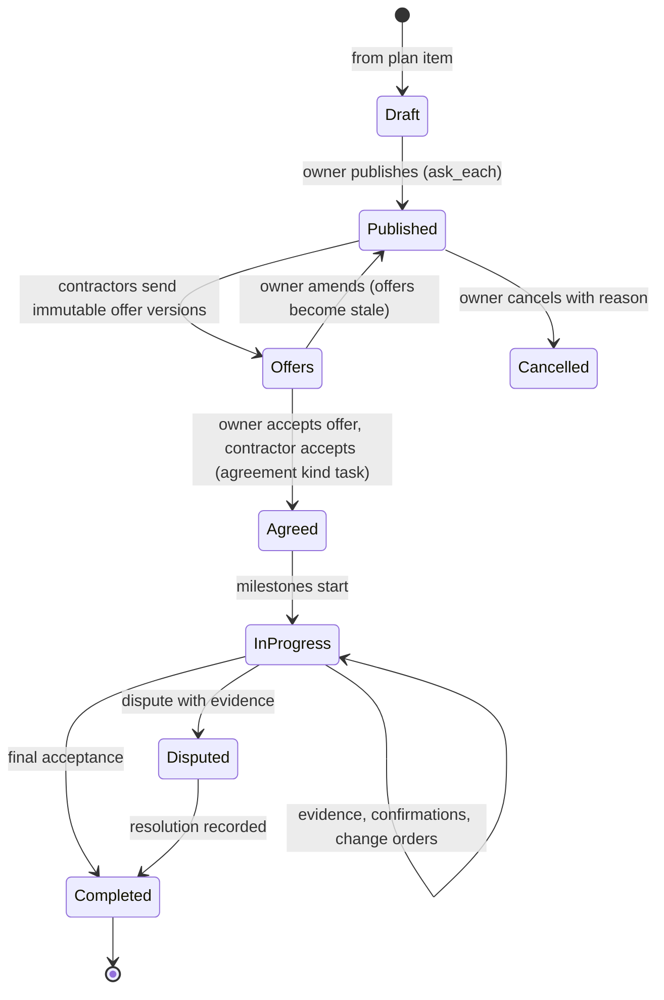

# Tasks and mentoring

Module code `TSK`. Status: **Proposed** (ADR 010 decision 17; R41, R42). Tasks reuse the **Contract** RFQ, quote-version and digest rules of commerce; acceptance creates an agreement with `terms_kind = task` (ADR 012 decision 19). Packages: TASK-001, CONS-001 (mentoring), COM-001, COM-002, EXE-001, PAY-002, MATCH-002, PERF-001, WEB-007. Narrative: [Task marketplace](../agent-catalog.md#task-marketplace), [Projects](../projects.md#consultations-and-tasks-from-plan-items-proposed). Data: [§8 Consultations, tasks and mentoring](../../data/model.md#8-consultations-tasks-and-mentoring).

## Purpose

Turn a plan item into a clear, scoped piece of work for a contractor or trade ("install a 200 A electrical service", "pour the slab foundation"), collect offers that are frozen once sent, accept terms both sides can prove are identical, and carry the work through milestones, evidence and payment. Mentoring is a longer relationship between an experienced practitioner and a newcomer whose sessions are consultations.

## Who uses it

Project owners (homeowners, developers, general contractors cutting packages), contractors, subcontractors and trades, mentors and mentees; the `task_marketplace`, `consultation` and `execution_clerk` agent modules.

## User stories

| # | Story | Status |
|---|---|---|
| TSK-S1 | As a homeowner, I want to publish a task to three electricians I chose, with drawings and schedule but without my budget, and compare their offers in plain language | Proposed |
| TSK-S2 | As an electrician, I want my agent to filter tasks by trade, region, licence and calendar and draft offers from my price list | Proposed |
| TSK-S3 | As an owner, I want an offer that names a licensed electrician to be confirmed by that electrician personally | Proposed |
| TSK-S4 | As a contractor, I want milestones with evidence and payment reminders, so that I get paid on time | Proposed |
| TSK-S5 | As a newcomer, I want a mentor who meets me monthly and helps me prepare for my licence exam | Proposed |
| TSK-S6 | As a contractor, I want to know how many other contractors received the task and that it was not sold to anyone | Proposed |

## Functional requirements

| ID | Requirement | Status | Packages |
|---|---|---|---|
| TSK-F01 | A task request is created from a plan item (or directly) with scope lines, quantities with units, drawings attached to that item, schedule window, site region, required licences and insurance, and acceptance criteria | Proposed | TASK-001 |
| TSK-F02 | Task request versions are immutable once published; amendments create a new version and flag earlier offers stale | Proposed | TASK-001, COM-001 |
| TSK-F03 | The owner chooses the audience: invited contractors, matching suggestions the owner approves, or the public needs board with a reduced projection | Proposed | TASK-001, MATCH-001 |
| TSK-F04 | A private client's task reaches only the contractors the client chose or explicitly consented to, up to a hub-configured cap; each contractor sees how many others received it; the client sees exactly who received it and why | Proposed | MATCH-002 |
| TSK-F05 | Receiving and answering a task is free; no hub may charge per lead, per view or per contact | Proposed | MATCH-002, BILL-003 |
| TSK-F06 | Offers are quote-like versions, immutable once sent, with lines, exclusions, taxes, schedule, milestones, payment terms and validity; private floors stay private | Proposed | TASK-001, COM-002 |
| TSK-F07 | An offer that names a licensed or certified person must be confirmed by that person from their own account; otherwise the name shows as "not confirmed" | Proposed | PERF-001 |
| TSK-F08 | Comparison shows exclusions, unknowns, schedule, licence and insurance status and taxes; it never shows a misleading single total for non-comparable scope | Proposed | TASK-001, COM-002 |
| TSK-F09 | Acceptance creates an agreement of kind `task` and a task assignment with milestones; consumer owners always accept themselves | Proposed | TASK-001, COM-002 |
| TSK-F10 | Milestones carry evidence (photographs, acts, inspection results); the owner confirms, partially confirms or disputes each | Proposed | EXE-001, FIELD-001 |
| TSK-F11 | Payments follow obligations through the hub's licensed provider where configured, otherwise outside the platform as agreed; deposit limits and cancellation rights come from the pack | Proposed | PAY-002, HOME-001 |
| TSK-F12 | Changes after acceptance are change orders with reasons and joint acceptance; client-caused changes never count against the contractor's timing | Proposed | FIELD-001, PLAN-001 |
| TSK-F13 | Task marketplace commission is a versioned hub price per value band, the same for everyone, shown before acceptance; zero allowed | Proposed | BILL-003 |
| TSK-F14 | Licence and insurance status of a contractor is shown as sourced or checked facts with dates; an unlicensed contractor cannot be offered a task the pack marks as licence-required without a visible warning | Proposed | CLM-001, REG-001 |
| TSK-F15 | Mentoring is a double-opt-in relationship (`proposed → active → paused → ended`) with goals; its sessions are consultations, free or paid | Proposed | CONS-001 |
| TSK-F16 | Either side can end mentoring at any time; notes are private to each side unless shared | Proposed | CONS-001 |
| TSK-F17 | Anti-splitting guard: for public clients, splitting a purchase to avoid thresholds is detected and escalated, never executed | Proposed | AGT-008 |
| TSK-F18 | Completed tasks propose a portfolio entry to the contractor with the owner's consent, never including the address | Proposed | REP-001 |

## Agent capabilities

| Capability | Kind | Mandate kind | Confirmation | Interface surface |
|---|---|---|---|---|
| `task_marketplace.draft_from_plan_item` | draft | `prepare` | `none` | Plan item → Hire for this |
| `task_marketplace.publish` | commit | `publish` | `mandate` (`ask_each`) | Task editor |
| `task_marketplace.list_invitations` | read | — | `none` | Tasks inbox (contractor) |
| `task_marketplace.draft_offer` | draft | `prepare` | `none` | Task → Offer |
| `task_marketplace.send_offer` | commit | `send_quote` | `mandate` (`ask_above(amount)`) | Task → Offer |
| `task_marketplace.confirm_named_performer` | commit | `send_quote` | `person_each` (the named person) | Offer card |
| `task_marketplace.compare_offers` | read | — | `none` | Task → Compare |
| `negotiation.negotiate_task_offer` | commit | `negotiate` | `mandate` (`ask_first(2)` in consumer mode) | Offer thread |
| `task_marketplace.accept_offer` | commit | `place_order` | `mandate` (`ask_each`); `person_each` in consumer mode | Offer card |
| `task_marketplace.record_milestone_evidence` | commit | `record_evidence` | `mandate` (`ask_first(5)`) | Milestone |
| `task_marketplace.confirm_milestone` | commit | `confirm_execution` | `person_each` | Milestone |
| `consultation.propose`, `consultation.accept` | commit | `introduce` | `mandate` (`ask_each`) | Mentoring card |

## Interface surfaces

| Surface | Where | Status |
|---|---|---|
| Task editor from a plan item | Plan item drawer | Proposed (WEB-007) |
| Tasks inbox and offer editor for contractors | `/app/sales` (task invitations) | Demo (sales list); Proposed (tasks) |
| Offer comparison | Task → Compare | Proposed |
| Task assignment with milestones and evidence | Project → Tasks | Proposed |
| Mentoring | My page → Mentoring | Proposed |

## Hub console settings

Task categories, who may answer (verification and licence requirements per category), fan-out cap for private clients, commission value bands, refund and dispute policy, licence-required categories from the pack ([console: marketplace](../hub-console/modules.md#consultation-and-task-marketplace)).

## Data entities

`task_request`, `task_request_version`, `task_offer`, `task_offer_private`, `task_assignment`, `mentoring_relationship` ([§8](../../data/model.md#8-consultations-tasks-and-mentoring)); `agreement`, `acceptance_event`, `obligation` ([§18](../../data/model.md#18-transactions)); `delivery_claim`, `work_record`, `acceptance_record` ([§19](../../data/model.md#19-execution-and-evidence)).

## Country and jurisdiction variations

Licence-required work categories (US state contractor and trade licences, for example electrical and plumbing; Germany's master-craftsman requirement for certain crafts; South Africa CIDB grades for public work), home-improvement contract rules (written contract contents, deposit limits, cooling-off), lien and prompt-payment law, tax on labour and materials, and insurance obligations (for example home building compensation cover in New South Wales for residential work above a threshold) come from packs and jurisdiction settings.

## Privacy rules

Invitees see only the shared fields of the item; they never see each other, other offers, the budget (unless shared) or the address before acceptance. Offers are visible to the owner and the offering contractor only. Mentoring notes are private per side.

## Metrics

Owner: offers received, comparison, schedule against plan. Contractor: invitations, offers sent, acceptance rate, on-time milestones (own). Hub cohorts: tasks published by category, median offers per task, fan-out distribution, disputes per category. Never per-lead revenue, because there is none.

## Edge cases

| Case | Behaviour |
|---|---|
| Owner amends scope after offers arrived | New version; offers flagged `stale_reason: request_amended`; contractors revalidate or withdraw |
| Two offers accepted at once by race | Acceptance locks the task; the second acceptance fails and becomes a decision |
| Named electrician never confirms | Offer shows "named performer not confirmed"; the owner can still accept knowingly or ask for a confirmed offer |
| Contractor's insurance expires mid-task | Notice to both sides; the engine does not cancel; the owner decides |
| Owner disappears after work is done | Payment reminders per obligations; evidence package for mediation; reputation records the unconfirmed state as unknown, not as failure of the contractor |

## Flow

## Open points

Fan-out cap default for private clients (hub setting; the research suggests a small number, for example three to five); see [conflicts to resolve](../conflicts-to-resolve.md) on tasks versus procurement-suite requisitions.
