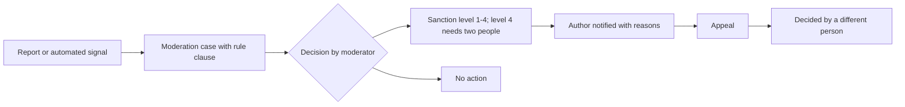

# Trust, safety, privacy and compliance

Module code `TSP`. Status: deny-by-default access, participation checks, projection serializers, the disclosure rule and row-level security are **Live** for the identity, company and project slice; restricted places and the ownership declaration with sanctions screening are **Live** (screening adapter needs a key); moderation, sanctions ladder, appeals, privacy operations, retention and incident tooling are **Designed**; hub-level privacy settings, review integrity, ranking statements, EU trader traceability, data-broker readiness and claim-wording guards are **Proposed**. Packages: BE-001 (done), INTL-SAN (done), ADM-001, PRV-001, PRV-002, REV-001, RANK-001, DSA-001, WORD-001, SUP-001, HUB-003, PROV-001, EVAL-001. Narrative: [Security, trust and privacy](../trust-safety-privacy.md), [Retention and privacy](../../data/retention-and-privacy.md), [Hub administration guard rails](../hub-administration.md#guard-rails-that-no-console-can-switch-off). Data: [§27 Administration, support and privacy operations](../../data/model.md#27-administration-support-and-privacy-operations).

## Purpose

Keep the gathering point trustworthy and lawful: impostors, fake reviews, ranking manipulation, harassment, spam, scam events and staff misuse are prevented or handled through cases with evidence and appeals; private data stays private, including from staff; every hub can follow its country's privacy, consumer, content and sanctions law through configuration.

## Who uses it

Every participant (reports, appeals, privacy requests); moderators, trust reviewers, the privacy officer, the compliance officer, support with case grants; hub owners who set policies.

## User stories

| # | Story | Status |
|---|---|---|
| TSP-S1 | As a person, I want to report harassment and see which rule clause a decision used, with an appeal decided by someone else | Designed |
| TSP-S2 | As a person, I want to export everything about me and request deletion, with a clear deadline | Designed |
| TSP-S3 | As a Californian, I want to opt out of sale or sharing, and the hub to honour Global Privacy Control | Proposed |
| TSP-S4 | As a buyer, I want certainty that no staff member reads my budget unless a second person granted a case for at most 72 hours, and that I can see the access log of my case | Contract (grants); Proposed (log view) |
| TSP-S5 | As a reader, I want to know the main parameters by which any list is ranked and that payment plays no role | Proposed |
| TSP-S6 | As an EU consumer, I want to know whether the seller is a trader and who they are before I buy | Proposed |

## Functional requirements

| ID | Requirement | Status | Packages |
|---|---|---|---|
| TSP-F01 | Deny by default; effective authority is the intersection of current rights, object grant, action conditions, mandate (for agents) and entitlement or budget | Live (slice) | BE-001 |
| TSP-F02 | Every object checks participation; no current-company shortcut | Live (slice) | BE-001 |
| TSP-F03 | Five projection layers, one serializer each, used by API reads, search, exports, notifications, agent context and federation; forbidden-field tests | Live (slice) | BE-001, FND-002 |
| TSP-F04 | Disclosure rule: "not found" when existence is not known to the principal; counts, autocomplete and search follow it | Live | BE-001 |
| TSP-F05 | Authorization epochs invalidate cached decisions and index entries on revocation | Live (slice) | BE-001 |
| TSP-F06 | Moderation: reports, cases, published rule clauses mapped to local law, notification of the author with reasons, sanction ladder (warning, temporary restriction, feature ban, suspension with two people), appeals by a different person | Designed | ADM-001, HUBC-004 |
| TSP-F07 | Review integrity controls and a public review policy (see REP-F12) | Proposed | REV-001 |
| TSP-F08 | Ranking statements per ranked surface generated from configuration, stating main parameters and that payment has no influence | Proposed | RANK-001 |
| TSP-F09 | Claim-wording guard: badge and label vocabulary is fixed and counsel-reviewed; "certified", "licensed", "guaranteed", "approved" only when bound to a register fact or recorded accreditation | Proposed | WORD-001, CLM-001 |
| TSP-F10 | Privacy operations: access, export, correction, deletion and opt-out requests with deadlines; exports through projection code (never counterparties' private fields); erasure by two people with an erasure ledger outside the restorable snapshot; legal holds; retention classes per country-pack bounds | Designed | PRV-001 |
| TSP-F11 | Hub privacy settings: notices, consent categories, opt-out of sale or sharing, Global Privacy Control, cookie policy, breach contacts and breach register with notification deadlines | Proposed | PRV-001 |
| TSP-F12 | Data-broker readiness before people sources are enabled; deletion platform adapters where law requires | Proposed | PRV-002 |
| TSP-F13 | EU trader traceability: before a trader sells to consumers in an EU hub, collect and make best efforts to verify traceability fields; show trader or non-trader status on offers; design interfaces so traders can meet their information duties | Proposed | DSA-001, CTRY-EU |
| TSP-F14 | Staff misuse prevention: no impersonation; case grants scoped, at most 72 hours, second-person approved, every read logged; conflict-of-interest declarations; full audit | Contract (grants); Designed | ADM-001, SUP-001 |
| TSP-F15 | Sanctions and export controls: restricted places never offered, hosted, served or federated; partners, paying organizers, operators and peers sign an ownership declaration; the full engine (jurisdiction gate and holds, baseline OFAC lists plus hub lists, review, gates, re-screening) is specified in [Sanctions compliance](sanctions-compliance.md) | Live (restricted places, declaration); Proposed (engine) | INTL-SAN, SANC-001 … SANC-009, HUB-003 |
| TSP-F16 | AI provenance and labelling for text, translations and images; agent disclosure wording per jurisdiction | Proposed | PROV-001, HUB-005 |
| TSP-F17 | No surveillance: no employee productivity views, no per-person behaviour analytics, pseudonymous operational logs, participant statistics as cohorts of at least ten | Designed (rule) | all |
| TSP-F18 | Minors: the engine is for professionals and does not target minors; policy per hub (O06) | Open | — |
| TSP-F19 | Takedown handling for copyright and unlawful content with notice, counter-notice and tombstones (for example a designated agent under the US DMCA where applicable) | Proposed | SRC-001, FED-002 |
| TSP-F20 | Incident records link kill switches, index taints, emergency content holds and account freezes; break-glass roles expire within hours; post-incident review required | Designed | OPS-004 |
| TSP-F21 | Scam events and courses: hosting policy, review, organizer ownership declaration and screening when payments are involved | Proposed | EVT-001, LRN-001 |
| TSP-F22 | Every automated decision that limits a person (ranking change, throttled introductions, suspended module) states the reason, the evidence and how to appeal | Proposed | REP-001, AGT-003 |

## Agent capabilities

| Capability | Kind | Mandate kind | Confirmation | Interface surface |
|---|---|---|---|---|
| `core.report_content` | commit | `communicate` | `mandate` (`ask_each`) | Report dialog |
| `core.file_appeal` | commit | `communicate` | `mandate` (`ask_each`) | Decision notice |
| `core.request_export` | govern | — | `first_party_step_up` | Settings → Privacy |
| `core.request_deletion` | govern | — | `first_party_step_up` | Settings → Privacy |
| `core.set_opt_outs` | govern | — | `first_party_form` | Settings → Privacy |
| `core.view_case_access_log` | read | — | `none` | Support case card |
| `core.explain_decision` | read | — | `none` | Any limitation notice |

## Interface surfaces

| Surface | Where | Status |
|---|---|---|
| Report and appeal dialogs | Every user-generated object | Designed |
| Privacy settings and requests | `/app/settings` | Proposed |
| Public pages: community rules, review policy, ranking statements, privacy notice, sub-processors, imprint | Public site | Proposed |
| Console: moderation, disputes, reputation methods, appeals, screening, confirmations; privacy requests, retention, settings, breaches | `/admin/hubs/[hub]/trust`, `/privacy` | Proposed |

## Hub console settings

Community rules and clause library, sanction ladder, screening lists, privacy notices and settings, retention classes and legal holds, breach contacts, ranking statement texts, review policy, trader traceability fields for EU hubs.

## Data entities

`staff_role_assignment`, `second_person_approval`, `case_access_grant`, `admin_audit_event`, `access_log_entry`, `support_case`, `moderation_report`, `moderation_case`, `sanction`, `appeal`, `privacy_request`, `privacy_preference`, `privacy_export`, `erasure_ledger`, `legal_hold`, `retention_policy`, `data_broker_registration`, `incident`, `kill_switch` ([§27](../../data/model.md#27-administration-support-and-privacy-operations)); `screening_list`, `screening_result`, `screening_review_case` ([§24](../../data/model.md#24-hubs-sources-and-verification)); `ownership_declaration` ([§5](../../data/model.md#5-companies)).

## Country and jurisdiction variations

Privacy law (GDPR and national laws, US state laws such as CCPA/CPRA, Brazil's LGPD, India's DPDP Act), residency rules, consumer protection (unfair practices, auto-renewal laws, fake-review rules), platform law (EU DSA, P2B; UK Online Safety Act duties where relevant), content and defamation law, AI disclosure, sanctions lists that a hub adds, breach notification deadlines and retention periods come from packs and hub settings; values need each hub's counsel ([ADR 012](../../adr/012-integrator-decisions-2026-10-31.md#questions-that-remain-for-the-owner-or-counsel), row 4).

## Privacy rules

This module defines them; see [cross-cutting rules](README.md#cross-cutting-rules-every-module-keeps).

## Metrics

Hub cohorts: reports by category and median decision time, appeals and reversal rates, privacy requests and deadline compliance, case grants issued and their duration, screening matches reviewed. Published in a periodic transparency report where the hub chooses or the law requires.

## Edge cases

| Case | Behaviour |
|---|---|
| Erasure requested while another party relies on accepted terms | Personal data redacted or pseudonymized; lawful evidence preserved under a legal basis; the person is told what was kept and why |
| Restore from backup after erasures | Erasure ledger replayed before the restored data serves |
| A moderator is the reported person's colleague | Conflict-of-interest declaration routes the case to another moderator |
| Screening false positive | Human review; the person can supply evidence; decisions recorded |

## Flow

## Open points

Retention periods and legal bases per hub (counsel); minors (O06); transparency report cadence.
