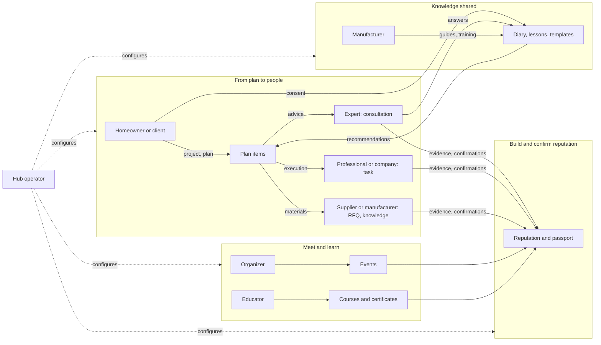

# Participants and their journeys

Who Trustwork serves, what each kind of participant comes for, which capabilities they use in which module, how their journeys run end to end, and what nobody can ever do to them. Status labels are those of [What works today](../status.md). The friendly, step-by-step versions of these journeys are the [guides](../../guides/README.md); what each participant's agent does in detail is the [agent catalogue](../agent-catalog.md#catalogue-by-participant); normative requirements are in the [module specifications](../modules/README.md).

## Participant types are lenses, not roles

A **participant type** is a lens for suggestions derived from optional onboarding preferences and from what a person actually does. It is never a role, confers no rights, is never shown to others and can be changed or cleared at any time ([agent catalogue vocabulary](../agent-catalog.md#vocabulary)). One person is often several types at once: a site engineer who writes articles, mentors newcomers and renovates their own flat. Rights come only from participation grants, company authority, staff roles and mandates.

| Page | Who | Guide |
|---|---|---|
| [Homeowners and clients](homeowners-and-clients.md) | Private homeowners, developers and client companies, public and institutional clients | [Homeowners and clients](../../guides/homeowner.md) |
| [Professionals and trades](professionals-and-trades.md) | Engineers, architects, estimators, site managers, foremen, installers, tradespeople, freelancers, job seekers | [Professionals and contractors](../../guides/professional.md) |
| [Experts and mentors](experts-and-mentors.md) | Experienced practitioners who give consultations, answers and mentoring | [Experts and mentors](../../guides/expert.md) |
| [Companies and their members](companies-and-members.md) | Contractors, subcontractors, design offices, developers as organisations; administrators, members, the standing representative | [Companies](../../guides/company.md) |
| [Suppliers and manufacturers](suppliers-and-manufacturers.md) | Distributors, suppliers, manufacturers as sellers and knowledge partners | [Suppliers and manufacturers](../../guides/supplier-manufacturer.md) |
| [Authors and editors](authors-and-editors.md) | Practitioner authors, journalists, the hub's editorial team | [Authors and editors](../../guides/author-editor.md) |
| [Event organizers](event-organizers.md) | Associations, companies, communities and individuals who host events | [Event organizers](../../guides/event-organizer.md) |
| [Educators](educators.md) | Course authors, trainers, training centres, manufacturers teaching their systems | [Experts and mentors](../../guides/expert.md) (courses) |
| [Hub operators and staff](hub-operators-and-staff.md) | Organisations that run a hub and their scoped staff | [Hub operators](../../guides/hub-operator.md) |
| [Contributors](contributors.md) | Developers, designers, translators, lawyers, practitioners, country-pack maintainers, people running coding agents | [How to help](../how-to-help.md) |

## Who uses which module

● main user · ○ occasional user · blank: not a user. Every participant uses identity, communications, search, the agent and their own reputation.

| Module | Homeowner / client | Professional | Expert | Company | Supplier / manufacturer | Author / editor | Organizer | Educator | Hub staff |
|---|---|---|---|---|---|---|---|---|---|
| [People and companies](../modules/people-and-companies.md) | ○ | ● | ● | ● | ● | ● | ○ | ○ | ● |
| [Projects and plans](../modules/projects-and-plans.md) | ● | ● | ○ | ● | ○ | | | | ○ |
| [Consultations](../modules/consultations.md) | ● | ○ | ● | ○ | ○ | | | ○ | ○ |
| [Tasks and mentoring](../modules/tasks-and-mentoring.md) | ● | ● | ● | ● | | | | ○ | ○ |
| [Knowledge sharing](../modules/knowledge-sharing.md) | ● | ● | ● | ○ | ○ | ● | | ○ | ○ |
| [Procurement and supply](../modules/procurement-and-supply.md) | ○ | ○ | | ● | ○ | | | | ○ |
| [Sales](../modules/sales.md) | | ● | ○ | ● | ● | | | | |
| [Catalogue and manufacturer knowledge](../modules/catalogue-and-manufacturer-knowledge.md) | ○ | ○ | | ● | ● | ○ | | ○ | ● |
| [Matching and partners](../modules/matching-and-partners.md) | ● | ● | ● | ● | ● | | ○ | | ○ |
| [Reputation builder and passport](../modules/reputation-and-passport.md) | ● | ● | ● | ● | ● | ● | ● | ● | ● |
| [Execution and field evidence](../modules/execution-and-field-evidence.md) | ● | ● | ○ | ● | ● | | | | ○ |
| [Getting paid](../modules/getting-paid.md) | ● | ● | ● | ● | ● | | ● | ● | ○ |
| [Billing and commissions](../modules/billing-and-commissions.md) | ○ | ○ | ○ | ● | ● | | ● | ● | ● |
| [Events](../modules/events.md) | ○ | ● | ● | ● | ● | ○ | ● | ○ | ● |
| [Learning and certificates](../modules/learning-and-certificates.md) | ○ | ● | ○ | ○ | ● | | ○ | ● | ● |
| [News, articles, magazine](../modules/publishing-and-editorial.md) | ● | ● | ● | ● | ● | ● | ○ | ○ | ● |
| [Hubs and the console](../modules/hubs-and-console.md) | | | | | | ○ | | | ● |

## The journeys that tie the engine together

## Promises that hold for every participant

- One person, one lifelong identity; publications, portfolio and reputation survive every change of employer.
- One agent per person; it acts only under mandates the person can read, change and revoke; chat text never authorizes; the stop control is always one click away.
- Private stays private: budgets, floors, negotiations and private projects never reach other parties, staff without a case grant, search, notifications, exports, other hubs or agents.
- Nobody can buy a ranking, a recommendation, a badge or a reputation, and nobody pays for a lead.
- Sourced, claimed and verified always look different; unknown is shown as unknown, never as failure.
- Every automated limit on a person is explained and can be appealed to a different person.
- Every visible string is in the participant's language; restricted places are never served.
