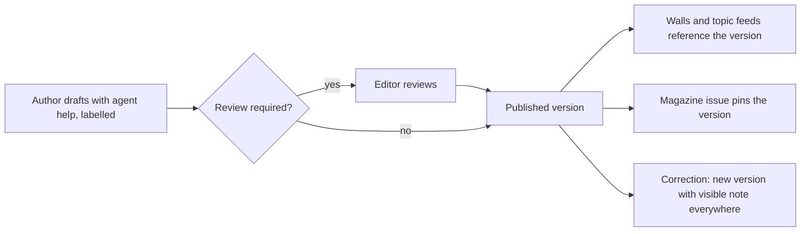

# Authors and editors

Practitioners who write, industry journalists, company communicators, and the hub's editorial team (editor-in-chief, editors, translators). Guide: [Authors and editors](../../guides/author-editor.md). Agent: [editor, author or expert](../agent-catalog.md#12-editor-author-or-expert); staff modules `editorial_desk`, `translation`.

## What they come for

To publish practical knowledge that is read, corrected visibly when needed, credited to them for life, translated honestly, and collected in a weekly magazine; for editors, to run a credible desk with an AI-assisted editorial office in which no pipeline publishes by itself.

## Capabilities by module

| Capability | Module | Status | Packages |
|---|---|---|---|
| Publications with formats, rubrics, topics, entity links, versions, corrections | [News, articles, magazine](../modules/publishing-and-editorial.md) | Contract / Demo | CNT-001, CNT-003 |
| Authorship separate from editing rights; authorship survives employer changes | [Publishing](../modules/publishing-and-editorial.md) | Contract | CNT-001 |
| Editorial workflow: review, schedule, embargo, correct, retract, hold | [Publishing](../modules/publishing-and-editorial.md) | Designed | CNT-001, HUBC-003 |
| Source registry with licence flags; imported items as drafts | [Data mining and sources](../modules/data-mining-and-sources.md) | Proposed | SRC-001 |
| Autonomous editorial office: discovery, clusters, drafts with attribution, translation, checks, labelled AI images, calendar, magazine assembly | [Publishing](../modules/publishing-and-editorial.md) | Proposed | EDIT-001, PIPE-001 |
| AI provenance labels | [Publishing](../modules/publishing-and-editorial.md) | Proposed | PROV-001 |
| Linked language editions with translator credit | [Publishing](../modules/publishing-and-editorial.md) | Proposed | CNT-001 |
| Magazine issues, PDF layout | [Publishing](../modules/publishing-and-editorial.md) | Demo / Designed | CNT-003 |
| Expert answers and knowledge formats | [Knowledge sharing](../modules/knowledge-sharing.md) | Proposed | KNOW-001 |
| Outbound ActivityPub for publications and issues | [Federation](../modules/federation-mesh.md) | Proposed | FED-006 |

## Journey

## What they build

Publications with sources, corrections made promptly, expert answers others reuse, translations reviewed; editors build the hub's reputation for accuracy.

## What can never happen

A published version silently changing; an imported item published without a person's decision; AI-written text without a label; a source licensed for display sent to a model or syndicated; readership numbers invented.

## Country and jurisdiction variations

Press and media law, right of reply, imprint duties, copyright and quotation, AI labelling duties, defamation thresholds.

## Their own metrics

Publications, corrections, aggregate reads where the hub measures them, reuse of answers; for editors, queue age and cost per published item.

## Open points

The personalized journal (O02); default comment policy.
