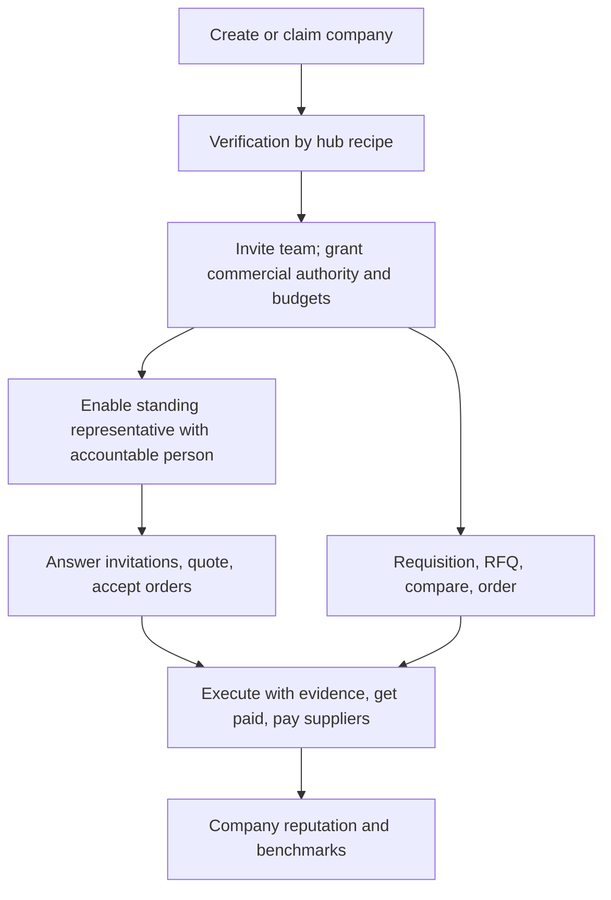

# Companies and their members

Organisations that build, design, develop and sell: general contractors, subcontractors and installer firms, design offices, developers and client companies, and the people in them (administrators, members with or without commercial authority) plus at most one standing representative per company. Guide: [Companies](../../guides/company.md). Agent: [general contractor](../agent-catalog.md#4-general-contractor), [subcontractor](../agent-catalog.md#5-subcontractor-or-installer-firm), [design office](../agent-catalog.md#8-design-office), [developer or client company](../agent-catalog.md#9-developer-or-client-company), [standing representative](../agent-catalog.md#16-company-standing-representative).

## What they come for

One honest company page shared by its people; being found and verified; buying and selling on the same day with frozen versions; requisition to pay for projects; prequalification shared by consent; getting paid; reputation as a company; continuity when people change jobs.

## Capabilities by module

| Capability | Module | Status | Packages |
|---|---|---|---|
| Company creation, page, memberships, one active employer per person, last-administrator rule, public handles | [People and companies](../modules/people-and-companies.md) | Live (API: memberships, creation, handles); Demo (page) | BE-001, BE-003 (done) |
| Claim and verification with hub recipes; registrations and licences as sourced facts | [People and companies](../modules/people-and-companies.md) | Proposed | CLM-001, HUB-003, REG-001 |
| Commercial authority separate from membership; transaction and platform budgets | [Billing](../modules/billing-and-commissions.md), [Agent](../modules/agent.md) | Contract | BILL-001, AST-001 |
| Catalogue, price lists, quotes, negotiation, order acceptance | [Catalogue](../modules/catalogue-and-manufacturer-knowledge.md), [Sales](../modules/sales.md) | Contract / Designed | COM-001, COM-002 |
| Requisitions, approval routes, sourcing events, purchase orders, receiving, invoices and three-way match | [Procurement and supply](../modules/procurement-and-supply.md) | Proposed | PRC-001 … PRC-014, WEB-011, WEB-012 |
| Bid on public and private tenders as a company: pursuits, compliance matrix, library, pricing with a margin guard, teaming, approvals and the person's submission | [Bid desk](../modules/bid-desk.md) | Proposed | BID-000 … BID-009, AGT-025, WEB-013, WEB-014 |
| Prequalification passport shared per client by consent | [People and companies](../modules/people-and-companies.md) | Proposed | PREQ-001 |
| Field evidence, change orders, pay applications, retainage, waivers | [Execution](../modules/execution-and-field-evidence.md), [Getting paid](../modules/getting-paid.md) | Proposed | FIELD-001, PAY-002 |
| Standing representative with a named accountable person; company mandates with re-confirmation | [Agent](../modules/agent.md) | Proposed | AGT-001 |
| Benchmarks against privacy-safe peer aggregates | [Analytics](../modules/analytics.md) | Proposed | BENCH-001 |
| Integrations with accounting and ERP; one system connected to the representative | [Integrations](../modules/integrations.md) | Proposed | INTEG-001, AGT-016 |

## Journey

## What they build

Delivered packages on time against agreed plans, change records with reasons, payment discipline towards subcontractors and suppliers, verified registrations and licences, prequalification evidence, portfolio with clients' consent.

## What can never happen to them or by them

No company or workspace switcher; no employee surveillance or per-employee metrics; membership never implies spending authority; no paid placement; a departed member's mandates are never silently inherited; the representative never exceeds the company's current grants and always names an accountable person.

## Country and jurisdiction variations

Company identifiers and forms, registers and claim evidence, licensing and grades, tax registration and e-invoicing, contractor obligations (for example Finland's checks before contracting), public procurement prequalification standards, payment and lien law.

## Their own metrics

Response time, win rate, on-time delivery, days to payment (both directions), open approvals, benchmarks with group sizes.

## Open points

Residual access to company history after a member leaves (O04); signing authority proofs (O05, O12).
