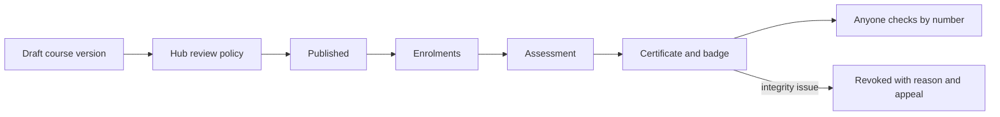

# Educators

Course authors, trainers, training centres, associations running continuing education, and manufacturers teaching installers their systems. Agent: [course author or trainer](../agent-catalog.md#14-course-author-or-trainer), module `course_studio`.

## What they come for

To publish short, practical courses tied to real work, assess fairly, issue certificates anyone can check and carry as verifiable credentials, record accreditation honestly, and earn from paid courses through licensed providers.

## Capabilities by module

| Capability | Module | Status | Packages |
|---|---|---|---|
| Course studio: modules, lessons, practice tasks, assessments, language editions, versions | [Learning and certificates](../modules/learning-and-certificates.md) | Proposed | LRN-001 |
| Certificates with a public check page; Open Badges 3.0 credentials | [Learning](../modules/learning-and-certificates.md), [Reputation](../modules/reputation-and-passport.md) | Demo (check page); Proposed | LRN-001, REP-002 |
| Accreditation records with source and validity | [Learning](../modules/learning-and-certificates.md) | Proposed | LRN-001 |
| Paid courses, revenue share as a hub setting, sponsored access labelled | [Learning](../modules/learning-and-certificates.md), [Billing](../modules/billing-and-commissions.md) | Proposed | LRN-001, BILL-002 |
| Trainings as events with attendance certificates | [Events](../modules/events.md) | Proposed | EVT-001 |
| Courses recommended on plan steps where they fit | [Search](../modules/search-and-cited-answers.md) | Proposed | REC-001 |

## Journey

## What they build

Courses with clear assessments, certificates issued and verified, learners who completed, accreditation where recorded.

## What can never happen

A certificate claiming a state qualification without a recorded accreditation; sponsors seeing who used sponsored access; employers seeing learners' progress.

## Country and jurisdiction variations

Recognised continuing-education schemes, mandatory safety training, consumer rules for online courses, tax on courses.

## Their own metrics

Enrolments, completions, pass rates (cohorts), certificates issued and revoked.

## Open points

First accreditation bodies the reference hub records.
