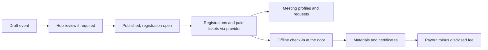

# Event organizers

Associations, companies, training centres, communities and individuals who host conferences, exhibitions, site visits, open days, webinars and meetups. Guide: [Event organizers](../../guides/event-organizer.md). Agent: [event organizer](../agent-catalog.md#13-event-organizer), module `organizer_desk`.

## What they come for

To publish an event that people find, sell tickets through a licensed provider with a disclosed fee, check people in at the door even offline, help attendees meet with purpose, publish materials and certificates, and build a reputation for events held as announced.

## Capabilities by module

| Capability | Module | Status | Packages |
|---|---|---|---|
| Event editor: programme, speakers with consent, ticket types and price versions, questions, capacity, waitlist | [Events](../modules/events.md) | Proposed | EVT-001, EVT-002 |
| Hosting under the hub's policy, with review where required | [Events](../modules/events.md) | Proposed | EVT-001 |
| Paid tickets, payouts, refunds through licensed providers; screening before payouts | [Events](../modules/events.md), [Getting paid](../modules/getting-paid.md) | Proposed | PAY-001, BILL-002 |
| Offline check-in on phones | [Events](../modules/events.md), [Mobile](../modules/mobile-and-offline.md) | Proposed | EVT-001 |
| Partner meetings and hosted-buyer meetings | [Events](../modules/events.md) | Proposed | EVT-001 |
| Announcements to registrants through templates only | [Communications](../modules/communications-and-notifications.md) | Proposed | COMMS-001 |
| Materials as publications; attendance certificates | [Publishing](../modules/publishing-and-editorial.md), [Learning](../modules/learning-and-certificates.md) | Proposed | CNT-001, LRN-001 |
| Federated calendars across hubs | [Federation](../modules/federation-mesh.md) | Proposed | FED-002 |

## Journey

## What they build

Events held as announced, materials published, certificates issued, refunds handled fairly.

## What can never happen

Selling or handing attendee lists to sponsors; public event ratings without evidence rules; mass mail to people who did not register; payment changing an event's position in listings.

## Country and jurisdiction variations

Ticket taxes, consumer rights for dated events, venue accessibility duties, continuing-education credit schemes.

## Their own metrics

Registrations, check-ins, meeting requests accepted, refunds, payouts (own events).

## Open points

Default hosting policy and fee disclosure format for the reference hub.
