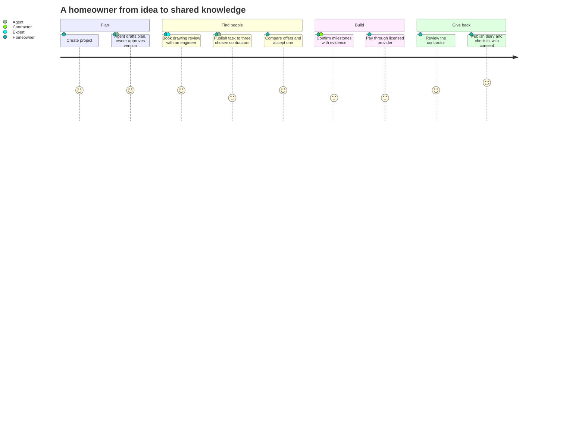

# Homeowners and clients

The people and organisations who want something built: a private homeowner adding a room in San Diego County, a small developer building four townhouses in Monterrey, a client company renovating a warehouse in Lyon, a school district or a city department procuring a facade retrofit. Guide: [Homeowners and clients](../../guides/homeowner.md). Agent: [private homeowner](../agent-catalog.md#10-private-homeowner), [developer or client company](../agent-catalog.md#9-developer-or-client-company), [public or institutional client](../agent-catalog.md#11-public-or-institutional-client).

## What they come for

To turn an idea into a clear plan, find the right people for advice and for the work, compare honest offers, agree on terms both sides can prove, follow progress with evidence, pay safely through licensed providers, and leave something useful for the next client. Clients have reputations too: payment discipline, fair change records and timely confirmations.

## Capabilities by module

| Capability | Module | Status | Packages |
|---|---|---|---|
| Account for life; projects owned personally or by the company | [Identity](../modules/identity-and-accounts.md), [Projects](../modules/projects-and-plans.md) | Live (API), Demo (screens) | BE-001 |
| Plan drafted by the agent: phases, trades, materials, permits, budget ranges, timeline, risks, decisions; versions the owner approves | [Projects and plans](../modules/projects-and-plans.md) | Proposed | PLAN-000, PLAN-001, AGT-010 |
| Explained, payment-blind recommendations per plan step | [Search](../modules/search-and-cited-answers.md), [Catalogue](../modules/catalogue-and-manufacturer-knowledge.md) | Proposed | MAT-001, REC-001, AGT-021 |
| Consultations (drawing review, quote review, site visit) | [Consultations](../modules/consultations.md) | Proposed | CONS-001, CONS-002 |
| Scoped tasks to chosen contractors with a request receipt | [Tasks](../modules/tasks-and-mentoring.md), [Matching](../modules/matching-and-partners.md) | Proposed | TASK-001, MATCH-002 |
| RFQs and requisitions for larger purchases | [Procurement and supply](../modules/procurement-and-supply.md) | Contract (versions); Proposed (suite) | COM-001, COM-002 |
| Honest comparison, negotiation inside a private ceiling, acceptance by digest | [Procurement](../modules/procurement-and-supply.md), [Sales](../modules/sales.md) | Contract | COM-002 |
| Milestones, evidence, confirmations, change orders, disputes | [Execution](../modules/execution-and-field-evidence.md) | Contract / Designed / Proposed | EXE-001, FIELD-001, DISP-001 |
| Milestone payments with deposit limits through licensed providers | [Getting paid](../modules/getting-paid.md) | Proposed | PAY-001, PAY-002, HOME-001 |
| Home passport: what was installed, warranties, maintenance, transfer on sale | [Projects](../modules/projects-and-plans.md) | Proposed | HOME-001 |
| Reviews tied to real work; diaries and lessons with consent | [Reputation](../modules/reputation-and-passport.md), [Knowledge](../modules/knowledge-sharing.md) | Designed / Proposed | EXE-001, KNOW-001 |
| Public tender desk for public clients: market sounding, specifications, clarifications, anti-splitting guard; never awards | [Procurement](../modules/procurement-and-supply.md) | Proposed | AGT-009, PROC-001 |

## Journey

## Consumer mode

A private person acting as a consumer is protected by **consumer mode**: they always accept and pay themselves (commitments are `human_only`), a seller's agent must show totals with taxes, false urgency and pressure are forbidden, cooling-off rights and deposit limits come from the country or state pack, and the plan is advice, not engineering or legal advice ([agent module](../modules/agent.md), AGN-F19).

## What they build

Payment discipline (on-time payments against agreed milestones), fair change records with reasons, timely confirmations, clear briefs, and knowledge contributions from completed projects.

## What can never happen to them

Their request is never sold as a lead or sent to people they did not choose or consent to; their budget, address and private notes never reach contractors before they choose to share; nobody sees other offers or other invitees; no contractor can buy a better position in their candidate list.

## Country and jurisdiction variations

Permits and inspections by county or city, home-improvement contract rules (written contract contents, deposit limits, cooling-off), licence-required trades, consumer protection, insurance obligations of builders (for example home building compensation cover in New South Wales), public procurement law for public clients, and subsidy programmes come from packs.

## Their own metrics

Plan progress, decisions due, budget against ranges (private), offers received, milestones confirmed, payments due.

## Open points

Default fan-out cap for private clients; commission levels the reference hub discloses; counsel review of state home-improvement rules before live use.
