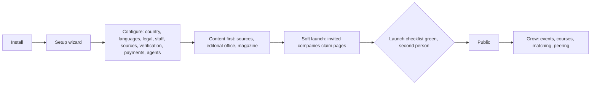

# Hub operators and staff

The organisation that runs a hub for a territory (an association, a trade publisher, a chamber of commerce, a university, an entrepreneur, a community) and its scoped staff: hub owner, staff admin, compliance officer, data steward, trust reviewer, editor-in-chief and editors, moderator, commercial admin, privacy officer, support agent and lead, ops engineer, auditor. Guide: [Hub operators](../../guides/hub-operator.md). Agent: [hub operator staff](../agent-catalog.md#15-hub-operator-staff), module `hub_ops` (drafts only, never decides).

## What they come for

To launch and run a lawful, useful hub without code; to fill it with sourced content and real companies honestly labelled; to configure law, payments, verification and agents for their territory; to serve participants without ever reading their private data unless a second person grants a short case; to keep the system healthy; to peer with other hubs.

## Capabilities by module

| Capability | Module | Status | Packages |
|---|---|---|---|
| Install, setup wizard, launch checklist, lifecycle | [Hubs and the console](../modules/hubs-and-console.md) | Proposed | INST-001, HUB-004, HUB-001 |
| Versioned configuration with second-person activation | [Hubs and the console](../modules/hubs-and-console.md) | Proposed | HUB-001 |
| Jurisdiction settings for agents | [Agent](../modules/agent.md), [Hubs](../modules/hubs-and-console.md) | Proposed | HUB-005 |
| Keys, providers, models, egress, caps, kill switches | [Hubs](../modules/hubs-and-console.md), [Integrations](../modules/integrations.md) | Proposed | KEYS-001 |
| Editorial office and sources | [Publishing](../modules/publishing-and-editorial.md), [Data mining](../modules/data-mining-and-sources.md) | Proposed | EDIT-001, SRC-001 |
| Datasets, links, registers, opportunities | [Data mining](../modules/data-mining-and-sources.md) | Proposed | MINE-001, REG-001, PROC-001 |
| Verification recipes, claims, screening | [People and companies](../modules/people-and-companies.md) | Proposed | HUB-003, CLM-001 |
| Agent product: modules, prices, extensions, external agents, abuse | [Agent](../modules/agent.md) | Proposed | AGT-003, AGT-004, AGT-023 |
| Billing: offers, prices, commissions, payouts, fair subscriptions | [Billing](../modules/billing-and-commissions.md) | Proposed | BILL-001 … BILL-004 |
| Support without impersonation; case grants | [Hubs](../modules/hubs-and-console.md) | Proposed | SUP-001 |
| Moderation, disputes, appeals, privacy operations | [Trust, safety, privacy](../modules/trust-safety-privacy-compliance.md) | Designed / Proposed | ADM-001, PRV-001 |
| Federation peering and licences | [Federation](../modules/federation-mesh.md) | Proposed | FED-001 |
| Backups, updates, health, incidents | [Operations](../modules/operations.md) | Proposed | OPS-003, OPS-004 |

## Journey

The full operator journey, from eligibility through a preset agent team to a growing company with people in every function, is in [The hub operating company](../hub-operating-company.md) (proposed).

## What they build

The hub's own trust: accurate content with visible corrections, honest labels, fair moderation with appeals, published prices and ranking statements, transparency about cases and requests.

## What can never happen

No ranking controls, no "featured" positions, no impersonation, no raw database or unrestricted export, no surveillance dashboards, no reading private objects without a 72-hour second-person case grant, no hub in a restricted place, no fake activity seeded at launch.

## Country and jurisdiction variations

Everything the operator configures is country-specific; the operator is responsible for local law and the engine provides controls, audit and guard rails, not legal advice.

## Their own metrics

Launch gates, queue ages, approvals waiting, cohorts of participation, spend against caps, incidents, locale completeness, accessibility evidence.

## Open points

Questions in the [console README](../hub-console/README.md#open-questions-for-the-owner); counsel reviews for the reference hub.
