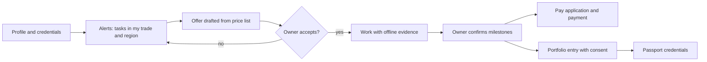

# Professionals and trades

People who do the work: engineers, architects, estimators, site managers, foremen, installers, electricians, plumbers, framers, roofers, freelancers and job seekers, employed or independent. Guide: [Professionals and contractors](../../guides/professional.md). Agent: [individual professional](../agent-catalog.md#1-individual-professional), [job seeker or freelancer](../agent-catalog.md#2-job-seeker-or-freelancer), [small contractor](../agent-catalog.md#3-small-contractor), [subcontractor or installer firm](../agent-catalog.md#5-subcontractor-or-installer-firm).

## What they come for

A professional story that belongs to them for life; being found by the client who needs exactly them; tasks and requests that fit their trade, region, licence and calendar; offers that cannot be quietly changed; getting paid on time; reputation built from confirmed work rather than bought; learning and certificates; a field-first agent on the phone.

## Capabilities by module

| Capability | Module | Status | Packages |
|---|---|---|---|
| Lifelong profile independent of employer; one active employer at a time | [People and companies](../modules/people-and-companies.md) | Live (identity, memberships); Demo (profile) | BE-001, PPL-001 |
| Credentials with hub checks and expiry reminders; statutory partner-check pack | [People and companies](../modules/people-and-companies.md), [Reputation](../modules/reputation-and-passport.md) | Proposed | REP-001, CLM-001, PREQ-001 |
| Capability profile; alerts with reasons; free answers to tasks and RFQs | [Matching](../modules/matching-and-partners.md), [Tasks](../modules/tasks-and-mentoring.md) | Proposed | MATCH-001, TASK-001 |
| Offers from a price list, sent within mandate; named-performer confirmation | [Tasks](../modules/tasks-and-mentoring.md), [Sales](../modules/sales.md) | Proposed | TASK-001, PERF-001 |
| Field evidence offline; milestone confirmations; change orders | [Execution](../modules/execution-and-field-evidence.md), [Mobile](../modules/mobile-and-offline.md) | Proposed | FIELD-001, CHAN-001 |
| Pay applications, lien waivers, prompt-payment reminders | [Getting paid](../modules/getting-paid.md) | Proposed | PAY-002 |
| Portfolio with client confirmation; passport; worker credential card | [Reputation](../modules/reputation-and-passport.md) | Proposed | REP-001, REP-002, CRED-001 |
| Engagements (open needs that want a person) as introductions | [Matching](../modules/matching-and-partners.md) | Proposed | AGT-007 |
| Courses and certificates; events and partner meetings | [Learning](../modules/learning-and-certificates.md), [Events](../modules/events.md) | Demo / Proposed | LRN-001, EVT-001 |
| Agent by SMS, WhatsApp and voice notes | [Communications](../modules/communications-and-notifications.md) | Proposed | CHAN-001 |

## Journey

## What they build

Licence and insurance checks, confirmed work stages with photographs, client confirmations, timeliness on tasks, knowledge contributions, certificates; individuals' history is person-controlled and never sold.

## What can never happen to them

They never pay for a lead, an introduction or a received request; their employer never sees a productivity dashboard about them or their learning progress; losing a job never loses their profile or reputation; a single bad event cannot silently destroy their standing (method, samples, disputes, appeals).

## Country and jurisdiction variations

Trade licensing (US state licences, master-craftsman rules, CIDB grades), site cards and safety training schemes, worker classification rules (Trustwork does not broker employment), lien and prompt-payment law, languages on site (for example Spanish in many US crews).

## Their own metrics

Invitations, offers, acceptance rate, on-time milestones, days to payment, evidence gaps.

## Open points

A first country for the worker credential card; how employer-confirmed work history interacts with FCRA-type rules where history informs hiring decisions (counsel).
