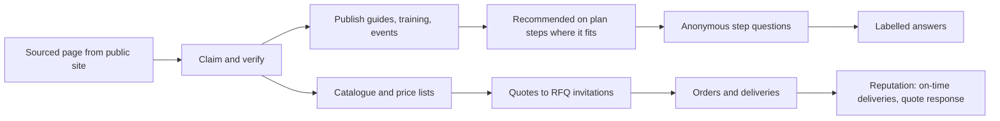

# Suppliers and manufacturers

Distributors, building-materials suppliers, equipment rental firms and manufacturers, as sellers and as knowledge partners. Guide: [Suppliers and manufacturers](../../guides/supplier-manufacturer.md). Agent: [supplier or distributor](../agent-catalog.md#6-supplier-or-distributor), [manufacturer](../agent-catalog.md#7-manufacturer), [manufacturers as knowledge partners](../agent-catalog.md#manufacturers-and-suppliers-as-knowledge-partners).

## What they come for

To be found at the plan step where their product helps, because it fits and never because they paid; to answer RFQ invitations quickly from their catalogue; to publish guides, training and events for installers; to claim and correct the page the hub built from their public site; to see aggregate signals about where their knowledge helps.

## Capabilities by module

| Capability | Module | Status | Packages |
|---|---|---|---|
| Sourced page built lawfully from the public site; claim and correct with provenance | [Catalogue and manufacturer knowledge](../modules/catalogue-and-manufacturer-knowledge.md) | Proposed | MAT-001, CLM-001 |
| Versioned catalogue, kits, price lists; public fields chosen | [Catalogue](../modules/catalogue-and-manufacturer-knowledge.md) | Contract / Designed | COM-001 |
| Free knowledge feed: guides, data sheets, warranties, training, events, technical articles | [Catalogue](../modules/catalogue-and-manufacturer-knowledge.md), [Publishing](../modules/publishing-and-editorial.md) | Proposed | MAT-001 |
| Anonymous step questions answered with labelled commercial answers | [Catalogue](../modules/catalogue-and-manufacturer-knowledge.md) | Proposed | AGT-021 |
| Quotes from catalogue, negotiation inside floors, order desk with capacity check | [Sales](../modules/sales.md) | Contract / Proposed | COM-002, AGT-008 |
| Supplier portal side of the procurement suite (purchase orders, deliveries, invoices) | [Procurement and supply](../modules/procurement-and-supply.md) | Proposed | PRC-001 … PRC-014, WEB-011, WEB-012 |
| Bid desk for public and private tenders: alerts with match reasons, bid/no-bid, cited compliance matrix, content library, documents in the buyer's format and language, specification checks, pricing with a margin guard, questions, teaming, reviews, human submission, debriefs; expert consultations | [Bid desk](../modules/bid-desk.md) | Proposed | BID-000 … BID-009, AGT-025, WEB-013, WEB-014 |
| Installer training as courses with certificates | [Learning](../modules/learning-and-certificates.md) | Proposed | LRN-001 |
| Events, open days, exhibitions; hosted-buyer meetings | [Events](../modules/events.md) | Proposed | EVT-001 |
| BIM product data (IFC property sets), EPDs and certificates | [Integrations](../modules/integrations.md), [Catalogue](../modules/catalogue-and-manufacturer-knowledge.md) | Proposed | BIM-001, MAT-001 |
| Aggregate signals only (cohorts of at least ten) | [Analytics](../modules/analytics.md) | Proposed | ANL-001 |

## Journey

## What they build

On-time deliveries confirmed, quote response time, product certificates and test reports, technical answers confirmed useful, courses with certificates issued.

## What can never happen

Paid positions in recommendations, matching or search; sponsored items outside a separate labelled slot (off by default); "who specified your product" or who read a guide; bulk outreach to them because they appear in a source; their sourced page losing the "from sources" label before they claim it.

## Country and jurisdiction variations

Product regulation and marking (the EU Construction Products Regulation and CE marking; US certification marks), environmental declaration programmes, database and copyright rights over product data, e-invoicing, tax on goods, units.

## Their own metrics

Quote response time, win rate, deliveries on time, aggregate views and saves of their resources, step questions answered.

## Open points

Whether the reference hub enables manufacturer crawling before counsel reviews US terms-of-service practice.
