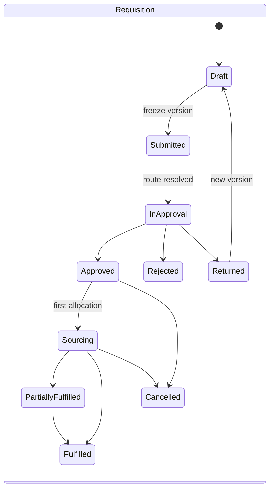
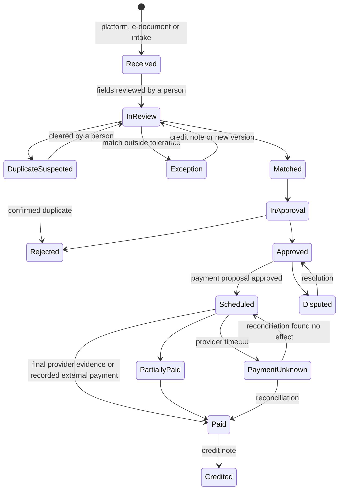

# Procurement and supply

Normative requirements: [Procurement and supply](modules/procurement-and-supply.md). Participants: [who uses what](participants/README.md).

Requirement R53 (with R05–R08, R10, R12, R14, R34, R41, R45, R46). Status: **Proposed** (owner request of 2026-10-31); the supplier base is **Live** in the API (PRC-003), nothing else in this chapter is implemented yet. It builds on what is already **Contract** or **Designed**: immutable RFQ and quote versions with digests, agreements, orders, obligations, delivery claims and acceptance records, two budget kinds with atomic reservations ([Buying and selling](commerce.md), [Billing](billing.md), [Execution and reputation](execution-and-reputation.md)). Work packages: PRC-000 … PRC-023, WEB-011, WEB-012, HUBC-011 and AGT-024 ([below](#work-packages)).

The supplier side of tenders (finding, qualifying, preparing, pricing and submitting bids) is designed separately in [The supplier bid desk](tender-desk.md).

[Buying and selling](commerce.md) designs one honest deal between two parties. A construction company needs more around it: site staff ask for materials, someone approves, a buyer merges requests and runs a competitive sourcing event, quotes and invoices arrive as PDFs from suppliers who are not on the platform, deliveries arrive in parts at a muddy gate with no signal, materials move between sites, an invoice must match what was ordered and received before anyone pays it, and the project budget must show what is planned, committed and spent. This chapter designs that company-side **procurement and supply suite**, from a plan step and its material takeoff to a payment executed by a licensed provider, plus the marketplace side that connects buyers and suppliers.

The owner shared the feature list of an existing requisition-to-payment product with a supplier marketplace as a checklist of common industry capabilities. Nothing here copies its text, names or interface; no integration with Russian providers or software is designed, and every integration below is internationally neutral and runs through an adapter with a fake.

## Contents

- [Rules this suite keeps](#rules-this-suite-keeps)
- [Gap analysis against the checklist](#gap-analysis-against-the-checklist)
- [The suite at a glance](#the-suite-at-a-glance)
- [From plan step to requisition](#from-plan-step-to-requisition)
- [Requisitions](#requisitions)
- [Approval routes](#approval-routes)
- [The company's supplier base](#the-companys-supplier-base)
- [Sourcing events and bid levelling](#sourcing-events-and-bid-levelling)
- [AI document intake](#ai-document-intake)
- [Equivalents, approved equals and substitutions](#equivalents-approved-equals-and-substitutions)
- [Project budgets and cost control](#project-budgets-and-cost-control)
- [Purchase orders, call-offs and external orders](#purchase-orders-call-offs-and-external-orders)
- [Deliveries and receiving](#deliveries-and-receiving)
- [Site stock and transfers](#site-stock-and-transfers)
- [Invoices and the three-way match](#invoices-and-the-three-way-match)
- [Payment proposals, schedules and payee protection](#payment-proposals-schedules-and-payee-protection)
- [Documents, completeness and e-invoicing networks](#documents-completeness-and-e-invoicing-networks)
- [Analytics without surveillance](#analytics-without-surveillance)
- [Integrations](#integrations)
- [Roles, permissions and mobile](#roles-permissions-and-mobile)
- [Agent parity: every operation is an agent capability](#agent-parity-every-operation-is-an-agent-capability)
- [The marketplace side](#the-marketplace-side)
- [Beyond the checklist: ideas ranked](#beyond-the-checklist-ideas-ranked)
- [Document states](#document-states)
- [Data model and contracts outline](#data-model-and-contracts-outline)
- [Hub console coverage](#hub-console-coverage)
- [Work packages](#work-packages)
- [Invariants checked by tests](#invariants-checked-by-tests)
- [Open questions for the owner](#open-questions-for-the-owner)

## Rules this suite keeps

Every capability below was checked against these rules. Where a checklist feature conflicts with one, the feature is adapted or declined, and the [gap analysis](#gap-analysis-against-the-checklist) says so.

| Rule | What it means for procurement and supply |
|---|---|
| Sent versions are immutable and digest-bound | RFQ, quote, requisition, levelling sheet, purchase order, invoice and payment-proposal versions freeze when they leave draft; approvals bind the exact digest and a material change voids them |
| One person, one agent, under mandates | The buyer's and the supplier's agents are modules of each person's one agent (or the company's one standing representative); they act only under structured mandates; chat never authorizes; approvals and confirmations that are `human_only` stay with people |
| Untrusted input never issues commands | Quotes, invoices, delivery notes, price lists, e-mails and e-documents are data: extraction drafts records, never approves, pays, changes bank details or contacts anyone |
| Payment never buys ranking | Supplier position in matching, sourcing invitations, levelling and recommendations ignores plans, entitlements and sponsorship; a paid plan buys capacity, never visibility |
| No held funds | Trustwork and hub operators never hold, pool or move money ([ADR 010](../adr/010-gathering-point-hubs-agents-and-mesh.md) decision 20); supplier payments run through the hub's licensed providers or are recorded as paid outside the platform with evidence |
| Private stays private | Budgets, ceilings, cost codes, levelling sheets, award reasons, supplier notes, blocks, stock and invoices never reach other parties, staff without a case grant, search, notifications, exports, other hubs, federation or agents of others |
| No employee surveillance | Metrics are company- or team-level; each person sees their own queue in a self-view; no individual buyer, approver, storekeeper or site worker ranking is ever shown to managers, unless the person explicitly consents to share their own figures |
| Sourced, claimed, verified | A supplier in a company's private list is not a platform member; a sourced product is information, not an offer; nothing becomes "verified" because a buyer typed it |
| Restricted places | No supplier, delivery address, warehouse, provider or e-document network in a restricted place is ever offered |
| Honest labels | Every extracted value shows its confidence and where it came from; estimates say "estimate"; demo data says "demo: no money moves" |
| Configuration, not code | Approval route templates, document types, e-invoicing networks, tolerances, units and thresholds are company settings, hub configuration or country-pack data ([Country specifics](country-specifics.md)) |

## Gap analysis against the checklist

Status: **Covered** means designed or contracted already (location given); **Partial** means a related design exists but the capability is incomplete; **Missing** means nothing exists yet. "Fit" says whether the capability fits Trustwork's rules as stated, needs adaptation, or is declined.

### 1. Purchase requisitions

| Capability | Status | Where today | Fit and decision |
|---|---|---|---|
| Create requests for materials and equipment | Partial | `need` and `need_line` ([model §16](../data/model.md#16-procurement)) are private intake for a buyer, not an internal request | Fits: new `requisition` with versions ([Requisitions](#requisitions), PRC-002) |
| Raised by site staff and departments | Missing | Needs are created by the owning party; no requester role | Fits: permission `procurement.requisition.create` scoped to projects and stock locations; departments as cost centres, not separate identities |
| Import from spreadsheets | Partial | `need_intake` agent module parses spreadsheets with evidence per line | Fits: deterministic CSV and XLSX templates plus AI intake ([AI document intake](#ai-document-intake)) |
| Merge several requests into one purchase | Missing | — | Fits: `requisition_allocation` traces each line into one need, RFQ, order, call-off or stock transfer |
| Priorities and deadlines | Partial | Plan items carry due dates; needs carry none | Fits: priority and needed-by date per requisition and line |
| Approval routes | Missing | Mandate approval policies cover agent actions only | Fits: configurable [approval routes](#approval-routes) per company, templates per hub (PRC-001) |
| Status tracking | Partial | `need.status` | Fits: requisition and line states with allocation progress |
| Change history and action log | Covered | `audit_event`, versioned records ([model §1.10](../data/model.md#110-audit-and-events)) | Fits as is; requisition versions add a readable history |

### 2. Suppliers

| Capability | Status | Where today | Fit and decision |
|---|---|---|---|
| A company's own supplier base | Partial | `rfq_private_constraint.shortlist`, `supplier_candidate` per RFQ, private CSV contacts (INTEG-001) | Fits: buyer-private `supplier_record` linked to directory entries without leaking ([Supplier base](#the-companys-supplier-base), PRC-003) |
| Finding new suppliers | Covered | Directory, explainable matching (MATCH-001), sourced manufacturer pages (MAT-001) | Fits as is |
| Matching by product category | Covered | `capability_profile.categories` and `step_terms` (PLAN-000) | Fits as is |
| Contact data and cooperation history | Partial | Contacts private; history spread over agreements | Fits: supplier card computed from the company's own records |
| Using supplier information to choose | Partial | Eligibility with evidence, reputation snapshots, DD-001, PREQ-001 | Fits: buyer-private assessments that never feed public reputation unless turned into a review tied to a real agreement |

### 3. Sourcing events

| Capability | Status | Where today | Fit and decision |
|---|---|---|---|
| RFQs to selected suppliers | Covered | COM-001 invitations pinned to RFQ versions | Fits as is |
| Receiving quotes | Covered | COM-002 quote versions | Fits as is |
| Competitive selection | Covered | `evaluation` with criteria and uncertainty | Fits as is |
| Comparing price and terms | Covered | `comparableQuoteVersions`, exclusions, exchange-rate snapshots | Fits as is |
| Bid-levelling sheets | Partial | Comparison shows exclusions but has no buyer adjustments | Fits: buyer-private `bid_level_sheet` versions (PRC-004) |
| Award approval | Partial | `place_order` needs authority and budget | Fits: `award_decision` through an approval route |
| Recording the outcome | Partial | Agreement and `rfq.accepted_agreement_id` | Fits: award reasons plus outcome notices to every invitee without others' prices |

### 4. AI processing of quotes and invoices

| Capability | Status | Where today | Fit and decision |
|---|---|---|---|
| Upload quotes and invoices | Partial | Files (FILE-001); need intake only | Fits: `intake_document` for quotes, invoices, credit notes, delivery notes, price lists, takeoffs (PRC-005) |
| Recognize line items | Partial | Need intake extracts lines with locators | Fits: extraction with confidence and locator per field |
| Match same and equivalent materials | Missing | Inputs exist: PLAN-000 taxonomy, MAT-001 product entries | Fits: `line_match` and equivalence rules; equivalent is never "approved" without a person (PRC-006) |
| Normalize units | Partial | Unit catalogue with conversion rules (CTRY-002) | Fits: plus product packaging conversions with sources |
| Auto-fill comparison sheets | Missing | — | Fits: extracted off-platform quotes fill a draft levelling sheet, labelled "from document, reviewed by" |
| Detect price and quantity discrepancies | Missing | — | Fits: discrepancy flags in intake and the [three-way match](#invoices-and-the-three-way-match) |

### 5. Budgets and cost control

| Capability | Status | Where today | Fit and decision |
|---|---|---|---|
| Procurement budgets per project or site | Partial | `budget` kind `transaction` with `project_id`; plan item estimate ranges | Fits: `cost_code` and `budget_line` under the project's transaction budget (PRC-007) |
| Material demand planning | Partial | Plan items of kind `material` and `purchase` with quantities | Fits: [plan to procurement](#from-plan-step-to-requisition) with takeoffs (PRC-015) |
| Control against approved budgets | Covered | Atomic reservations; concurrent orders cannot exceed a budget | Fits as is |
| Planned versus actual | Missing | — | Fits: `cost_entry` ledger: planned, committed, actual, forecast |
| Limit overrun control | Partial | Reservation fails at the limit | Fits: warnings at configurable thresholds before the hard stop, and an approval route for budget changes |
| Material cost analysis and reports | Missing | — | Fits: company-private analytics (PRC-014) |

### 6. Invoice approval and payments

| Capability | Status | Where today | Fit and decision |
|---|---|---|---|
| Receive supplier invoices | Missing | Billing `invoice` is the hub's own fee invoice | Fits: new `trade_invoice` between participants or from an external supplier (PRC-010) |
| Check against the agreed purchase | Missing | — | Fits: three-way match order–receipt–invoice with tolerances |
| Approval routes | Missing | — | Fits: same approval routes |
| Payment registers | Missing | — | Fits: `payment_proposal` versions, approved as a whole (PRC-011) |
| Payment scheduling | Partial | Obligations of kind `pay` with due dates; pay applications (PAY-002) | Fits: scheduled instructions with early-payment terms |
| Payment status | Partial | `payment` states through providers (PAY-001) | Fits: plus status visible to the supplier ("approved", "scheduled", "paid") |
| Transfer to accounting | Partial | INTEG-001 names accounting adapters | Fits: object mappings for suppliers, orders, receipts, invoices and payments (PRC-013) |

### 7. Orders and logistics

| Capability | Status | Where today | Fit and decision |
|---|---|---|---|
| Purchase orders | Covered | `order` from an agreement (COM-002) | Fits; adds call-offs and external orders |
| Delivery deadlines | Covered | `obligation` kind `deliver` with `due` | Fits as is |
| Order tracking | Partial | Order status only | Fits: dispatch notices with carrier reference and ETA |
| Partial deliveries | Covered | `delivery_claim` lines, partial `acceptance_record` | Fits as is; receiving adds the buyer's side |
| Quantity and cost control | Partial | Obligation scope | Fits: order-line balances (ordered, received, accepted, invoiced, returned) |
| Deviations from agreed terms | Partial | `order_change`, disputes | Fits: deviations detected at receipt and invoice match |
| Order closing | Partial | Status `fulfilled` | Fits: close with remaining quantity cancelled and commitment released |

### 8. Receiving and inventory

| Capability | Status | Where today | Fit and decision |
|---|---|---|---|
| Register deliveries at a site or warehouse | Partial | `acceptance_record` | Fits: `goods_receipt` with photos, offline capture (PRC-008) |
| Match against orders | Partial | Delivery claim lines reference quote lines | Fits: receipt lines reference order lines |
| Accepted quantities | Covered | `acceptedQuantity`, `contestedQuantity` | Fits as is |
| Shortages and discrepancies | Partial | Contested quantities, defects | Fits: typed discrepancies (short, over, damaged, wrong item, late, documents missing) and a supplier notice |
| Stock balances | Missing | — | Fits: `stock_movement` ledger and balances per location (PRC-009) |
| Movement of materials | Missing | — | Fits: issues to work, transfers between sites, returns, write-offs |
| Primary documents | Partial | Evidence references; FIELD-001 | Fits: document types per country pack and completeness checks (PRC-012) |

### 9. Documents

| Capability | Status | Where today | Fit and decision |
|---|---|---|---|
| Storage of procurement documents | Covered | Attachments with classification (FILE-001) | Fits as is |
| Invoices, delivery notes, country-specific transfer documents | Partial | Country facets list e-invoicing and acceptance acts | Fits: document types as country-pack data |
| Document approvals | Missing | — | Fits: approval routes with subject kind `document` |
| Completeness checks | Partial | `compliance_checker` checks tender completeness | Fits: requirement sets per subject (order, receipt, invoice, supplier onboarding) |
| Electronic document exchange | Partial | E-invoicing facet and adapter named | Fits: `e_document_exchange` through network adapters with fakes |
| History | Covered | Versions and audit | Fits as is |

### 10. Analytics

| Capability | Status | Where today | Fit and decision |
|---|---|---|---|
| Purchase volumes | Missing | — | Fits: company-private (PRC-014) |
| Spend by project | Missing | — | Fits: from the cost ledger |
| Price comparison over time | Partial | Per-RFQ comparison | Fits: own price history; hub benchmarks only above a minimum group ([ideas](#beyond-the-checklist-ideas-ranked)) |
| Supplier performance | Partial | Reputation snapshots, timeliness observations, BENCH-001 | Fits: own on-time and match-exception rates per supplier, private to the buyer |
| Requisition fulfilment | Missing | — | Fits |
| Sourcing cycle times | Partial | Contractor KPIs; hub median durations | Fits |
| Buyer team efficiency | Missing | — | **Adapted**: team-level throughput and queue ages only; self-view for each person; no individual ranking for managers without the person's consent |
| Management reports and BI | Partial | Agent reports; public API (INTEG-001) | Fits: report drafts and a scoped export of the company's own data |

### 11. Integrations

| Capability | Status | Where today | Fit and decision |
|---|---|---|---|
| Accounting and ERP systems | Partial | INTEG-001 (QuickBooks Online, Xero) | Fits: adapters for QuickBooks Online, Xero, Sage, NetSuite, SAP Business One with fakes; no Russian software |
| Electronic document exchange | Partial | Country facet only | Fits: Peppol (UBL), CFDI, NF-e and others as country-pack networks |
| Transfer purchases, invoices and deliveries | Missing | — | Fits: object mappings and idempotent export jobs (PRC-013) |

### 12. Users

| Capability | Status | Where today | Fit and decision |
|---|---|---|---|
| Permissions | Covered | Company permissions, object participation | Fits; adds procurement permissions |
| Roles | Covered | Membership roles | Fits as is |
| Approval routes | Missing | — | Same as 1 |
| Action control | Covered | Audit, access log | Fits as is |
| Cross-department collaboration | Partial | Context threads | Fits: cost centres and threads per requisition, order and invoice |
| Mobile | Partial | Responsive web; field channels and offline mobile web (CHAN-001) | Fits: offline receiving and requisitions from a photo |

### 13. Marketplace for buyers

| Capability | Status | Where today | Fit and decision |
|---|---|---|---|
| Publish needs | Covered | `open_need`, needs board (MATCH-001) | Fits as is |
| Send requisitions to the marketplace | Partial | Need to open need or RFQ | Fits: an approved requisition line can become a published need or RFQ in one step |
| Find suppliers | Covered | Directory, matching | Fits as is |
| Broadcast RFQs | Partial | Public RFQ projection; consented fan-out (MATCH-002) | **Adapted**: broadcast only to suppliers who opted in to the category and region, within the outreach quota; no paid reach |
| Receive and compare quotes | Covered | COM-002 | Fits as is |
| Alternative suppliers | Partial | `alternatives_allowed`; matching | Fits: alternatives proposed during a sourcing event, explained |
| Supplier information | Covered | Company pages, sourced/claimed/verified, DD-001, PREQ-001 | Fits as is |
| Supplier ratings | Covered | Evidence-backed reputation and reviews tied to real agreements | Fits as is; never bought |

### 14. Marketplace for suppliers

| Capability | Status | Where today | Fit and decision |
|---|---|---|---|
| Register | Covered | Sign-up, company creation, claims | Fits as is |
| Supplier profile | Covered | Company page, capability profile, catalogue | Fits as is |
| Product categories and delivery regions | Covered | `capability_profile.categories`, `regions`; delivery regions as offering availability | Fits as is |
| Receive matching requests | Covered | `opportunity_watch`, alert subscriptions | Fits as is; same moment for every plan |
| Search requests | Covered | Needs board, public RFQs | Fits as is |
| Send and revise quotes | Covered | Quote versions, revalidation after amendments | Fits as is |
| Competitive price information to an allowed extent | Missing | — | **Adapted**: never another bidder's price; opt-in outcome feedback in bands after award, and anonymized benchmarks above a minimum group ([ideas](#beyond-the-checklist-ideas-ranked)) |
| Information on potential buyers | Partial | Public company pages and project pages | Fits only for public data; a buyer's budgets, projects and history never |
| A personal account manager | Missing | — | **Declined as a paid service**: a paid human who boosts a supplier would sell reach. Replaced by the supplier's own agent and the hub's support workspace, equal for every plan |
| Business events | Covered | Events module (EVT-001) | Fits as is |

### Summary

| | Covered | Partial | Missing | Total |
|---|---|---|---|---|
| Capabilities | 29 | 42 | 23 | 94 |

Three capabilities are adapted (team-level instead of per-buyer efficiency, opted-in broadcast instead of paid reach, banded outcome feedback and benchmarks instead of competitors' prices) and one is declined (a paid account manager). Nothing on the checklist requires holding funds or a Russian integration, and nothing is dropped without a replacement.

## The suite at a glance

```mermaid
flowchart LR
  PS[Plan step] --> TO[Takeoff]
  TO --> RQ[Requisition]
  SITE[Site request: form, photo, spreadsheet, agent] --> RQ
  RQ -->|approval route| AP{Approved}
  AP -->|from stock| TR[Stock transfer]
  AP -->|framework| CO[Call-off order]
  AP -->|sourcing| SE[Need and RFQ]
  SE --> Q[Quote versions]
  DOC[Off-platform quote PDF] -->|AI intake, human review| Q2[Captured quote]
  Q --> BL[Bid levelling sheet]
  Q2 --> BL
  BL -->|approval route| AW[Award decision]
  AW --> AG[Agreement]
  AG --> PO[Purchase order]
  CO --> PO
  PO --> DN[Dispatch notice]
  DN --> GR[Goods receipt, partial]
  GR --> ST[Site stock]
  TR --> ST
  ST --> ISS[Issue to work or surplus]
  PO --> INV[Trade invoice]
  INV --> M3{Three-way match}
  GR --> M3
  M3 -->|exceptions to people| INV
  M3 -->|approval route| PP[Payment proposal]
  PP -->|approval route| PAY[Licensed provider or recorded external payment]
  PO -.commitment.-> CL[Cost ledger: planned, committed, actual]
  INV -.actual.-> CL
```

| Area | Section | Work package |
|---|---|---|
| Contracts for the whole suite | [Data model](#data-model-and-contracts-outline) | PRC-000 |
| Approval routes | [Approval routes](#approval-routes) | PRC-001 |
| Requisitions | [Requisitions](#requisitions) | PRC-002 |
| Supplier base | [Supplier base](#the-companys-supplier-base) | PRC-003 |
| Sourcing and levelling | [Sourcing](#sourcing-events-and-bid-levelling) | PRC-004 |
| Document intake | [AI document intake](#ai-document-intake) | PRC-005 |
| Equivalents and substitutions | [Equivalents](#equivalents-approved-equals-and-substitutions) | PRC-006 |
| Cost control | [Budgets](#project-budgets-and-cost-control) | PRC-007 |
| Receiving | [Receiving](#deliveries-and-receiving) | PRC-008 |
| Stock | [Stock](#site-stock-and-transfers) | PRC-009 |
| Invoices and match | [Invoices](#invoices-and-the-three-way-match) | PRC-010 |
| Payments and payee protection | [Payments](#payment-proposals-schedules-and-payee-protection) | PRC-011 |
| Documents and e-invoicing | [Documents](#documents-completeness-and-e-invoicing-networks) | PRC-012 |
| Accounting and ERP | [Integrations](#integrations) | PRC-013 |
| Analytics | [Analytics](#analytics-without-surveillance) | PRC-014 |
| Plan to procurement | [Plan step to requisition](#from-plan-step-to-requisition) | PRC-015 |
| Ideas | [Ideas](#beyond-the-checklist-ideas-ranked) | PRC-016 … PRC-022 |
| Agent parity registry | [Agent parity](#agent-parity-every-operation-is-an-agent-capability) | PRC-023 |
| Web, console, agent | [Agent parity](#agent-parity-every-operation-is-an-agent-capability), [console](#hub-console-coverage) | WEB-011, WEB-012, HUBC-011, AGT-024 |

The suite serves every size. A homeowner never sees requisitions or approval routes: their plan items become RFQs directly ([Projects](projects.md#plans-from-plan-to-people)). A two-person contractor uses requisitions without routes (the default route is "the owner approves"). A general contractor with ten sites uses all of it. Modules switch on per company in settings and per hub in the console; nothing here is required to buy or sell.

## From plan step to requisition

Status: **Proposed** (PRC-015). The flagship journey "plan to people" ([ADR 010](../adr/010-gathering-point-hubs-agents-and-mesh.md) decision 17) gets its supply leg here.

1. **Plan step.** An approved plan version contains items of kind `material` and `purchase` with plan-step terms from the open taxonomy (PLAN-000), quantity ranges and estimate ranges.
2. **Takeoff.** The owner or their agent produces a `takeoff`: quantities per material and zone, from a manual entry, a spreadsheet, or an adapter to a specialist takeoff tool. The engine does not build its own drawing takeoff (the [market scan](../research/market-and-ideas-2026-10.md) found accuracy liability); takeoff lines cite their source file and page, and remain "estimate" until a person confirms them.
3. **Demand schedule.** Takeoff lines are spread over the plan timeline: each line gets a needed-by date from the plan item's start, minus the lead time the agent knows (from the supplier's offering availability or the company's own history, never from another company's private data).
4. **Requisitions.** The person confirms which lines become requisitions now; the agent drafts them grouped by delivery location and needed-by window. Lines keep `plan_item_key` and `step_terms`, so recommendations (REC-001), manufacturer guides (MAT-001), equivalents and EPD data attach automatically.
5. **Re-planning.** When a plan change is approved, every requisition, RFQ and order linked to an affected item is flagged `stale_reason: plan_changed` (a flag, like RFQ amendments) and shown in decisions waiting; nothing is cancelled automatically, and timing attribution follows the plan change's accountable party ([fair timing](execution-and-reputation.md#fair-timing-who-caused-the-delay)).

## Requisitions

Status: **Proposed** (PRC-002).

A **requisition** is an internal request inside one company (or one person's project) for materials, equipment hire, tools or services, raised by whoever needs them and approved by whoever may spend.

- **Who raises it.** Any member holding `procurement.requisition.create` for the project or stock location: a site engineer, a foreman, a storekeeper, an estimator, an office department (a cost centre). Departments are cost centres, not identities: a person still acts as themselves.
- **How.** A form; a CSV or XLSX upload against a published template (columns: description, step term or catalogue reference, quantity, unit, needed by, location, cost code, notes); a photo of a handwritten list or a voice note through the agent ([field channels](agents.md#external-channels), CHAN-001) that becomes a **draft** with extraction evidence; a plan takeoff; or a reorder suggestion from stock minimums.
- **Content.** Versioned: lines with description, step terms, optional catalogue or product reference, exact quantity and unit, alternatives allowed, estimate (optional, labelled), needed-by date, priority (`routine`, `urgent`, `critical`), delivery location, cost code, plan item. Submitting freezes a version with a digest; editing after submission creates a new version and supersedes pending approvals.
- **Approval.** The company's [approval route](#approval-routes) for subject kind `requisition` resolves approvers by amount, category, project and cost code.
- **Sourcing.** After approval a buyer (or the buyer's agent) **allocates** each line: from stock (transfer), from a framework agreement (call-off), to a new or existing need and RFQ, or directly as an order from an offering version the company already agreed. Several requisitions merge into one purchase: each allocation records which requisition line and how much went where, so the requester sees progress line by line ("2 of 3 lines ordered, 1 received").
- **States.** `draft → submitted → in_approval → approved | rejected | returned`, then `sourcing → partially_fulfilled → fulfilled | cancelled` ([states](#document-states)).
- **History.** Every version, approval decision, allocation and status change is visible to the requester and approvers; the audit trail holds actor, time, mandate and digest.

## Approval routes

Status: **Live** in the API (PRC-001, `apps/api/src/modules/approval-routes`); console templates are proposed (HUBC-011). The requester never decides, without exception (the sole-person audit flag applies to the other built-in rules); the worker job that runs the escalation sweep is a follow-up.

Approval routes are the company's own versioned rules for who must approve what. They are human decisions; agents prepare them.

| Element | Design |
|---|---|
| Subject kinds | `requisition`, `award`, `order`, `order_change`, `trade_invoice`, `payment_proposal`, `document`, `substitution`, `budget_change`, `payee_change`, `supplier_status` |
| Steps | Ordered or parallel steps; each step has conditions (amount above or below, category, project, cost code, supplier status, risk signal present) and an approver selector (holders of a permission in the project or company, a named person, the project leader, "any two of") with a quorum |
| Segregation of duties | Built-in rules a route cannot switch off: the requester never approves their own subject; the person who changed a payee's bank details never approves a payment to that payee; the person who recorded a receipt never alone approves the matching invoice above a company threshold; a payment proposal's preparer never alone approves it. Small companies with one eligible person get an explicit warning and an audit flag instead of a silent bypass |
| Delegation | An approver delegates to a colleague for a period, for chosen subject kinds and up to a limit, never above their own rights; delegation ends with membership |
| Timeouts and escalation | Reminders as decisions waiting; after a timeout the step escalates to the selector's next person; nothing is approved by silence |
| Versions | `approval_route_version` rows: drafted, activated by a member holding `procurement.routes.manage`; a hub may require a second person; history keeps which version applied to each decision |
| Hub templates | Hubs publish route templates ("small contractor: owner approves everything above USD 0"; "general contractor: project manager up to USD 25,000, then commercial director"); a company starts from a template and adapts it. Templates contain no customer data |
| Binding | Each `approval_request` binds the subject version id and digest; a material change supersedes the request; each `approval_decision` is append-only and records the digest it approved |
| Agents | Approving is the mandate action `approve`, which is **`human_only`**: an agent prepares the decision card with the evidence; the person decides on the first-party surface (the page or the assistant overlay) |

## The company's supplier base

Status: **Live** in the API (PRC-003, [module](../../apps/api/src/modules/supplier-base/README.md)); no interface yet (WEB-011). Not yet live: country-pack document types for the checklist (PRC-012), prequalification passport sections (PREQ-001), due-diligence packs (DD-001), and the receipt, invoice and document figures of the card (PRC-008, PRC-010, PRC-012).

Each company keeps a **private supplier base**: the suppliers it works with or considers, with its own statuses, notes and history.

- A `supplier_record` belongs to the buying company and is `party_private`. It links to at most one of: a platform company (claimed or verified), a sourced directory record, or an **external counterparty** the buyer created for a supplier that is not on the platform.
- **Linking without leaking.** Linking reads only the supplier's public projection. The supplier never learns it is in a buyer's list, which status it has ("preferred", "on hold", "blocked") or what the buyer wrote; none of it reaches search, notifications, the supplier's agent, reputation, federation or hub statistics. A private block is never a public signal.
- **External counterparties** are not platform members: they are never published, never counted in directories, never receive platform outreach without a channel grant from the buyer, and accrue no reputation. If that company later joins and claims its page, the buyer may link the record; nothing private moves into the public projection.
- **Supplier card.** Computed from the buyer's own records only: agreements and orders, receipts and discrepancies, match exceptions, on-time rate, open invoices, documents with expiry (insurance certificates, licences, tax forms), prequalification passport sections the supplier shared by consent (PREQ-001), public reputation snapshot and due-diligence pack (DD-001) where available.
- **Assessments.** A buyer may record a periodic, criteria-based assessment with evidence references. It stays private unless the buyer chooses to share it with that supplier, who may respond. It feeds public reputation only by becoming a review tied to a real agreement, through the normal review rules.
- **Onboarding checklist.** Per company and category: required documents (from the country pack's document types, for example a US tax form and a certificate of insurance), screening status (performed by the hub), payee verification ([below](#payment-proposals-schedules-and-payee-protection)).
- **Import.** CSV or XLSX of existing suppliers creates private records and external counterparties only (INTEG-001 rule: an import never creates directory members or claims).

## Sourcing events and bid levelling

Status: **Proposed** (PRC-004), built on RFQs and quotes (COM-001, COM-002).

A **sourcing event** is an RFQ with its invitations, clarifications, quotes, levelling and award; no new top-level object is needed. What is added:

- **Invitation lists** from the supplier base, matching (MATCH-001) and opted-in broadcast, with eligibility rules taken from the buyer's private constraints (licence category, insurance minimum, prequalification sections, region, screening clear). Eligibility shows pass, fail and unknown; unknown is not failure.
- **Sealed until the deadline (optional).** A buyer may set the RFQ to reveal quotes only after the response deadline, which protects suppliers from bid shopping; the setting is part of the published RFQ version, visible to suppliers.
- **Bid levelling sheet.** A buyer-private, versioned working document over pinned quote versions (id and digest) and captured off-platform quotes. Per line it shows the normalized quantity and unit (conversion rule cited), unit price, exclusions, alternates and options, taxes and currency (dated rate snapshot), delivery terms and lead time, and optionally embodied carbon ([ideas](#beyond-the-checklist-ideas-ranked)). Buyer **adjustments** (a plug value for an excluded item, a risk allowance) are separate, labelled "buyer estimate" with a source, and never alter a quote. Stale quote versions are marked non-comparable. Totals are recomputed exactly; there is no hidden weighting.
- **Award decision.** Selected quote versions (whole or by line, with split awards), reasons, the frozen levelling sheet version, and an approval request through the route for subject kind `award`. Execution creates agreements and orders only through COM-002 commands with authority and budget reservation.
- **Outcome notices.** Every invitee gets a notice: awarded, not awarded or cancelled. With the buyer's opt-in, after award, a not-awarded supplier also sees a **band** of where their total stood relative to the awarded total (within 5 %, within 15 %, above 15 %) and the reason category (price, lead time, scope, eligibility). Never another bidder's name, price or line, and never before award.
- **Agents.** The buyer's agent drafts the RFQ, chases suppliers who have not answered (within outreach quotas and through the RFQ context only), answers clarifications from approved facts, drafts the levelling sheet and flags gaps; the supplier's agent drafts or sends quotes within private floors ([agent parity](#agent-parity-every-operation-is-an-agent-capability)).

## AI document intake

Status: **Proposed** (PRC-005), using the model gateway (LLM-001), object storage (FILE-001) and the unit catalogue (CTRY-002).

Most construction paperwork arrives as PDFs, scans and photos from suppliers who use other systems. Intake turns them into reviewed drafts.

| Step | Design |
|---|---|
| Arrival | Upload, forwarded e-mail through a channel grant, e-document network receipt, mobile photo, API. Each becomes an `intake_document` with kind (quote, invoice, credit note, delivery note, price list, takeoff, requisition sheet, certificate), content digest and the sender's claimed identity, labelled untrusted |
| Deduplication | Same content digest, or the same issuer, number and amount, is flagged as a possible duplicate before any extraction cost is spent |
| Extraction | Structured e-documents (UBL, CFDI, NF-e XML) are parsed deterministically; PDFs and images go through an extraction adapter (OCR plus a model route chosen by the hub, with a fake). Every field and line carries a value, a **confidence** between 0 and 1 and a **locator** (page and region, or cell) |
| Egress | Documents are `party_private`; they leave the node only to a model provider the hub's egress matrix allows for that data class; otherwise the deterministic or local route runs, or the item waits for manual entry |
| Line matching | Each extracted line is matched to the RFQ line, quote line, order line, catalogue offering, product entry or stock item, with match kind `exact`, `equivalent` (cites an equivalence rule), `substitute_proposed` or `unmatched` |
| Unit normalization | Through the unit catalogue (dimension conversions such as square feet to square metres) and product packaging conversions with a cited source (a 94 lb bag, a pallet of 60 bags); a conversion without a source stays unconverted and flagged |
| Discrepancies | Price differs from the agreed unit price; quantity exceeds ordered or received; unit differs; tax differs from the tax determination; total does not add up; due date or payment terms differ; payee details differ from the verified payee ([fraud controls](#payment-proposals-schedules-and-payee-protection)) |
| Review queue | A person reviews side by side (document and extracted fields), corrects, and accepts. Low-confidence fields are highlighted; a company may set a confidence threshold below which a field must be touched, but **no threshold lets intake approve, pay, order or change anything**. The accepted review creates a draft: a captured quote, a trade invoice in `in_review`, a receipt draft, a requisition draft, a price list draft |
| Untrusted content | Text in a document never becomes an instruction: "pay to this new account", "approve before Friday", e-mail addresses, links and phone numbers found in a document are data, shown with warnings where risky |
| Cost | Pages parsed count against the `document_pages` meter; the person sees an estimate before large batches |

Hub settings ([console](#hub-console-coverage)): which extraction adapters and model routes are allowed per data class, default confidence thresholds, retention of original files, languages, and whether external OCR is permitted at all.

## Equivalents, approved equals and substitutions

Status: **Proposed** (PRC-006), using the plan-step taxonomy (PLAN-000) and manufacturer data (MAT-001).

- **Equivalence rules** say when two items can be compared as the same: both carry the same plan-step material term and the same values for the attributes that matter (for example strength class, fire classification, thermal resistance, standard designation, size). Rules are hub data (public, sourced, reviewed) or company-private rules. A rule cites its basis (a standard or the specification section) and never claims compliance with a code it has not sourced.
- **Equivalent is not approved.** Intake and levelling may say "equivalent by rule R" so that quotes compare; using a different product than specified needs a **substitution request** with spec evidence (data sheets, test reports, EPDs), decided through the approval route for subject kind `substitution`, and, where the project has a designer of record, by that designer. An agent never approves a substitution.
- **Approved equals** are substitution decisions that a project or company keeps for reuse; they carry scope (this project, this company) and expiry.
- Manufacturers and suppliers may propose alternatives in a quote as options; they show as alternates in levelling, never silently replacing the specified line.

## Project budgets and cost control

Status: **Proposed** (PRC-007), extending budgets and reservations (BILL-001).

| Figure | Source | Meaning |
|---|---|---|
| **Planned** | `budget_line` amounts per cost code under the project's transaction budget, seeded from plan item estimate ranges or imported | What the owner approved to spend |
| **Committed** | `cost_entry` of kind `commitment` when an order or call-off is accepted, adjusted by order changes, released at order close | What the company has promised to pay |
| **Actual** | `cost_entry` of kind `actual` when a trade invoice is approved, reversed by credit notes | What suppliers have invoiced and the company accepted |
| **Forecast** | Committed plus remaining requisitions and open sourcing estimates, labelled estimate | Where the budget is heading |
| **Paid** | From payment instructions with final provider evidence | Cash out |

- Cost codes are the company's own (or imported from its accounting system or a template); they map to plan-step terms so that the same material shows in plan, budget and analytics.
- **Overrun control.** The hard stop stays the atomic reservation: an order cannot commit beyond the remaining transaction budget. Before that, configurable warnings (for example at 80 % and 95 % of a budget line, or when forecast exceeds planned) appear as decisions waiting for the budget owner. A budget increase is a `budget_change` through the approval route, linked to a plan change where one exists.
- Budgets, cost codes and the ledger are `owner_private` or `party_private` to the buyer; suppliers, invited experts and staff without a case grant never see them.

## Purchase orders, call-offs and external orders

Status: **Proposed** extensions of COM-002 (PRC-002, PRC-004, PRC-008).

- **Purchase orders** remain `order` rows from an accepted agreement. Order-line balances (ordered, dispatched, received, accepted, invoiced, returned, open) are a derived view.
- **Framework agreements and call-offs.** An agreement may be a framework (rates and maximum quantities or value for a period); each **call-off** orders against it and cannot exceed the remaining quantity or value (serialized like budget reservations). Proposed contract extension: `terms_kind = framework` (integrator review, AGT-002 and COM-002).
- **External orders.** For suppliers not on the platform, the buyer records an `external_order` (frozen payload and digest), sends it through a channel grant or exports a PDF, and records the supplier's acknowledgement as evidence. It goes through the same budget reservation, receiving, match and payment steps, but it is never shown as a platform transaction and yields no reputation for anyone.
- **Tracking.** A platform supplier sends **dispatch notices** (lines, carrier, tracking reference, expected arrival); the buyer's agent watches them and the delivery slots. Carrier tracking adapters are optional and have fakes.
- **Deviations.** Detected at dispatch (quantity or item differs), receipt (short, over, damaged, wrong, late) and invoice match (price, quantity, tax). Each opens a context thread with the supplier and, if needed, an order change or a dispute (DISP-001).
- **Closing.** A buyer closes an order line with a reason; the remaining open quantity is cancelled through an order change accepted by both sides where the agreement requires it, and the commitment is released.

## Deliveries and receiving

Status: **Proposed** (PRC-008; delivery coordination PRC-016).

- **Goods receipt.** At the gate the storekeeper or foreman records what arrived against the order (or external order, transfer or return): received, accepted and rejected quantities per line, discrepancy type, photos of goods and the delivery note, and a note. The delivery note can be photographed and run through intake to prefill lines. A receipt is not acceptance of quality by default; where the agreement needs acceptance, the buyer records an `acceptance_record` for the supplier's delivery claim, and both stay separate records ([Execution](execution-and-reputation.md#execution-records)).
- **Partial deliveries** are normal: each receipt adds to the order-line balance; the requester's requisition progress updates.
- **Offline.** The mobile web app (CHAN-001) captures receipts without signal: a client-generated id, device time and photos are queued and synced; the server records its own time beside the device time; duplicates collapse on the client id. A receipt synced late shows both times; timing evidence uses the server time unless a person confirms the device time.
- **Photos.** Stored with capture time and optional location; location and faces never appear in any projection outside the buyer and that supplier, and never in a public view ([FIELD-001 rule](execution-and-reputation.md)).
- **Supplier notice.** A discrepancy creates a structured notice to the supplier (platform) or a drafted message (external), and if confirmed, a return or a credit-note request.
- **Delivery coordination.** Each site or warehouse may publish to its suppliers, after an order is accepted, a `site_logistics_profile` (access hours, gate instructions, vehicle limits, safety requirements, a role-based contact). Suppliers propose a **delivery slot**; the buyer confirms or moves it; slots can reserve a **site resource** (crane, hoist, loading bay, forklift) without double booking. Just-in-time call-offs are scheduled from the plan's dates minus lead times. Addresses and access instructions reach only suppliers with an accepted order.

## Site stock and transfers

Status: **Proposed** (PRC-009).

- **Stock locations**: sites, warehouses, yards and vehicles owned by the company, optionally linked to projects.
- **Stock items**: the company's material identities, each linked to a catalogue offering, product entry or plan-step material, with a base unit and optional lot tracking.
- **Movements** (append-only): receipt, issue to work (with cost code and plan item), transfer out and in, return to supplier, adjustment with reason, write-off with reason, surplus listed and surplus sold. Balances are computed per item and location. Corrections append; nothing is edited.
- **Transfers** between sites are requested, optionally approved, dispatched and received like a small order, and can satisfy a requisition line before anything is bought.
- **Reorder points** per item and location propose requisition drafts; they never order by themselves unless a mandate allows the call-off.
- **No surveillance.** Movements record who recorded them for audit; no report aggregates movements, issues or write-offs per person, and no "shrinkage by employee" view exists. Investigations of loss use the normal case process with reasons.

## Invoices and the three-way match

Status: **Proposed** (PRC-010; fraud signals shared with PRC-011).

- **Trade invoices** are invoices between participants (or from an external supplier to a participant). They are distinct from the hub's own fee `invoice` in billing. A platform supplier issues one from an order, a pay application (PAY-002) or a milestone; an external supplier's invoice arrives through intake or an e-invoicing network and is captured by the buyer.
- Each **issued version** is immutable with a digest; corrections are credit notes or replacement versions that reference the corrected one, as the country pack requires. Tax lines use `tax_determination` like quote lines.
- **Three-way match** compares, per line, the order (agreed unit price and quantity), the receipts (received and accepted quantity) and the invoice (invoiced quantity, price, tax). Results: matched, within tolerance, price variance, quantity variance, no receipt, no order, tax variance, duplicate suspected. Two-way match (order and invoice) applies to services and to lines the company marks as not receivable; four-way match adds an acceptance record where the agreement requires inspection.
- **Tolerances** are a company setting (percentage and absolute per line and per invoice, separate for price, quantity and tax), versioned, with hub defaults.
- **Exceptions** go to people: the buyer, the receiver, or the supplier through a thread ("line 3 invoiced 120, received 100"). A supplier may answer with a credit note or a new invoice version.
- **Approval.** Matched invoices follow the approval route for subject kind `trade_invoice` (many companies auto-route matched invoices under a threshold to a single approver; nothing is approved without a person). Approval creates the `actual` cost entry.
- **Duplicates.** Before match: same supplier and normalized invoice number; same amount and date from the same supplier within a window; same content digest arriving through two channels; an e-invoice and a PDF of the same document. A suspected duplicate cannot be approved until a person clears it.
- **Supplier view.** The supplier sees each invoice's status (received, in review, approved, scheduled for a date, paid, disputed with reason category), never the buyer's internal approvers, budget or match notes. This visibility and the resulting payment timeliness feed the buyer's payment timeliness evidence ([PAY-002](commerce.md)), fairly attributed.

## Payment proposals, schedules and payee protection

Status: **Proposed** (PRC-011), executed only through the payment provider port (PAY-001).

### Proposals and schedules

- A **payment proposal** is a versioned list of approved invoices (or milestones and retainage releases from PAY-002) the company intends to pay, with amounts, scheduled dates, early-payment discounts the supplier offered, and the funding transaction budget. It is approved through the route for subject kind `payment_proposal`; approval binds the digest.
- Each item becomes a **payment instruction** with one of two modes:
  - `provider`: executed through a licensed payment provider configured by the hub (for a US hub, ACH or card through a licensed processor; elsewhere what the hub enabled). The engine sends the instruction, stores provider references and reconciles webhooks; `outcome_unknown` goes to reconciliation and is never retried blindly.
  - `external_recorded`: the company pays from its own bank outside the platform and records the payment with evidence (remittance, bank reference); the supplier may confirm receipt. The engine never moves money in this mode.
- The engine **never holds, pools or routes funds** through an operator account; PAY-001 refuses such a configuration. Instructions can never exceed an invoice's open amount (serialized).
- The supplier sees "scheduled for" and "paid on" with the provider reference category, never the buyer's cash plan.

### Payee protection and payment-fraud controls

Construction is a frequent target of invoice and bank-detail fraud. The suite treats it as a product feature, not an afterthought.

| Control | Design |
|---|---|
| Payee accounts without raw bank data | A supplier's receiving account is a provider token with a masked display and a keyed fingerprint for change detection; account numbers are entered only in the provider's hosted form ([no card or bank data stored](billing.md#trustwork-never-holds-money)) |
| Who can change payee details | Only the supplier company itself, through its verified company account by a member holding `company.billing.manage` with a second factor. A document, e-mail, chat message or another agent can never change them; such a request creates a **bank-detail change warning** for the buyer |
| Verification | New or changed details are verified by the provider (account validation where available) and by an out-of-band callback to a contact the buyer had on file **before** the change, recorded with who called and when |
| Cooling-off | A changed payee becomes usable after a company-set cooling-off period (proposed default three business days); payments scheduled in that window are held for a person |
| Separation | The person who verified a payee change cannot alone approve the first payment to it |
| Risk signals | `payment_risk_signal` rows for duplicate invoice, bank-detail change, first payment to new details, look-alike sender domain, urgency or secrecy language in an e-mail or document, amount far outside the supplier's history, invoice without order. An open signal blocks approval of the affected payment until a person clears it with a reason |
| Business-email-compromise warnings | Inbound messages on procurement threads from a sender domain that differs slightly from the supplier's known domain, or that ask to change payment details, are labelled in the thread and in the decision card |
| Agents | `release_payment` is never pre-authorizable for a payee changed within the cooling-off period or with an open signal; agents never call a number found in a document |

## Documents, completeness and e-invoicing networks

Status: **Proposed** (PRC-012; country facts belong to the country packs).

- **Document types are country-pack data.** Each type has a key, label keys in every language, issuer side, which subjects it attaches to, retention class, whether it is structured (XML schema) and its source. The engine knows no country.
- **Requirement sets.** A company (from a hub template) states which documents each subject needs: supplier onboarding, order, receipt, invoice, payment, project handover. Completeness shows present, missing, expired and in review; it can be a condition in an approval route ("no payment while the certificate of insurance is expired").
- **Document approvals** use the route subject kind `document`.
- **E-document exchange** through network adapters, each with a fake and idempotency per network and external id: issue, receive, status. Exchange records keep the network's acceptance or rejection evidence.

Illustrative pack data (every fact must be sourced and carry its verification level in the pack before use; these rows are candidates, not verified facts):

| Country or area | E-invoicing | Other procurement documents | Pack |
|---|---|---|---|
| United States | No federal mandate for business-to-business e-invoicing; voluntary networks exist | Vendor tax form for information reporting, certificate of insurance, sales-tax resale or exemption certificates, lien waivers (PAY-002), bill of lading | INTL-US |
| European Union | European standard EN 16931 with UBL 2.1 or CII syntax; Peppol network; business-to-government mandatory, business-to-business mandates phasing in per member state | Delivery notes, CE declarations of performance for construction products | CTRY-EU and member-state packs |
| Mexico | CFDI issued through authorized certification providers, mandatory | Transport complement for goods in transit | CTRY-MX |
| Brazil | NF-e for goods and NFS-e for services, mandatory | Electronic transport document for carriers | CTRY-BR |
| India | E-invoicing through the government invoice registration portal above thresholds | E-way bills for goods movement | CTRY-IN |
| Uzbekistan, Georgia, Armenia, Azerbaijan | As recorded in each pack's tax facet | As recorded | INTL-UZ, INTL-GE, INTL-AM, INTL-AZ |

The engine ships a UBL 2.1 serializer and parser as the neutral structured format, plus a fake access point; live network access points are hub provider connections with second-person activation.

## Analytics without surveillance

Status: **Proposed** (PRC-014).

All figures are computed from the company's own records, are private to members with `procurement.analytics.view`, and follow the rules below.

| Report | Contents |
|---|---|
| Spend | By project, cost code, plan-step material, supplier, period; committed versus actual versus planned |
| Prices | Own unit-price history per material and supplier, with unit normalization; index overlays ([ideas](#beyond-the-checklist-ideas-ranked)) |
| Suppliers | Own on-time receipt rate, discrepancy rate, match-exception rate, invoice cycle, documents expiring; never another buyer's data |
| Requisition fulfilment | Lines fulfilled on time, average days from approval to receipt, lines sourced from stock |
| Cycle times | Requisition to approval, RFQ to award, award to order, receipt to invoice approval, approval to payment |
| Team throughput | Queues and ages per team or cost centre (minimum group size: a team of fewer than three people shows only totals for the company) |
| My work | Each person's own queue, ages and decisions, visible only to that person |

- **No individual rankings.** There is no report of buyers, approvers, storekeepers or site staff by speed, volume or errors. A person may choose to share their own figures with their manager for a period; the consent is recorded and revocable.
- **Reports and BI.** The agent drafts monthly management reports from these figures; a company can export its own data (CSV, XLSX, or the public API scopes of INTEG-001) to its BI tool. Exports never include other parties' private data.

## Integrations

Status: **Proposed** (PRC-013 on top of INTEG-001). Every integration is an adapter with a fake, a declared data mapping, idempotent export jobs, and costs metered and shown to the hub.

| Kind | Candidates (hub chooses; none assumed available) | Objects |
|---|---|---|
| Accounting and ERP export | QuickBooks Online, Xero, Sage (Intacct and Business Cloud), Oracle NetSuite, SAP Business One | Suppliers (vendors), cost codes (classes or dimensions), purchase orders, receipts, approved trade invoices (bills), credit notes, payments |
| Construction project tools import | Procore, Autodesk Construction Cloud | One's own project budgets, cost codes, commitments and vendors, imported as private records |
| Takeoff and estimating | Specialist takeoff tools through extensions (AGT-023) | Takeoff lines with source references |
| Files | CSV and XLSX templates for requisitions, suppliers, cost codes, price lists, stock counts | Import creates private records only |
| Structured documents | UBL 2.1 (Peppol BIS), country-pack formats (CFDI, NF-e) | Invoices, credit notes, orders, dispatch advice |
| Payments | The hub's licensed payment providers (PAY-001) | Payment instructions and outcomes |

No Russian software, provider or network is integrated. Exports run under the company's mandate or a member's action and record what was sent, with a digest; an unknown export outcome is reconciled, never re-sent blindly.

## Roles, permissions and mobile

Proposed company permissions (the company's membership roles bundle them; people keep one identity and one employer):

| Permission | Allows |
|---|---|
| `procurement.requisition.create` | Raise requisitions for assigned projects or locations |
| `procurement.requisition.source` | Allocate approved lines, merge, create needs and RFQs |
| `procurement.suppliers.manage` | Edit the supplier base, statuses and assessments |
| `procurement.sourcing.run` | Run sourcing events, levelling, propose awards |
| `procurement.order.place` | Place orders and call-offs (still bounded by budget reservations) |
| `procurement.receive` | Record receipts and discrepancies at assigned locations |
| `procurement.stock.manage` | Transfers, adjustments, write-offs at assigned locations |
| `procurement.invoice.process` | Capture invoices, resolve match exceptions |
| `procurement.payments.prepare` | Prepare payment proposals |
| `procurement.budget.view` / `.manage` | See or change budget lines and cost codes |
| `procurement.routes.manage` | Edit and activate approval routes and tolerances |
| `procurement.analytics.view` | Company analytics |

Approving is not a permission on its own: it comes from being selected by an approval route step, which itself requires the person to hold the right for that subject. Members' views are scoped by project participation and stock location, not by a company-wide switch.

**Mobile.** Requisitions, approvals, receipts with photos, transfers and invoice status work at 375 px, keyboard and screen reader; receiving works offline (CHAN-001); complex levelling sheets say "more comfortable on a wide screen" and remain operable.

## Agent parity: every operation is an agent capability

[ADR 010](../adr/010-gathering-point-hubs-agents-and-mesh.md) decision 23 (owner, 2026-10-31): every participant-facing capability is available through the person's own agent and directly in the interface, from **one capability registry** that the agent runtime, the person's connected AI chat over MCP and the interface all use, with a generated parity report in CI. For this suite each operation is registered once with a **kind** (`read`, `draft`, `commit`), contract-derived inputs and outputs, the data classes it touches, the **mandate action** that authorizes it, its default **confirmation policy** and its meter. The UI flow and the agent call the same use case with the same checks; the agent never has a shortcut the UI lacks, and the UI never has a function the agent cannot reach.

Rules that keep parity safe:

- `read` capabilities return only what the person may see; they need no mandate beyond the person's own session or a connection scope (`read.private` for private procurement data is opt-in per class for external connections).
- `draft` capabilities create drafts only; drafts never leave the company and never commit money.
- `commit` capabilities need a mandate action, a context, limits, budgets where money is committed, and the confirmation policy below. `human_only` means the agent prepares a decision card bound to the action digest, and the person confirms it on the first-party surface (page or assistant overlay, with step-up where required); a connected external agent can propose but never confirm it.
- New mandate actions proposed for AGT-002: `approve` (approval decisions; `human_only`), `release_payment` (payment instructions; `ask_each` default), `maintain_records` (the company's own internal procurement records: supplier base, cost codes, stock movements, settings; `ask_first(5)` default).

| Operation | UI flow | Capability | Kind | Mandate action | Default confirmation |
|---|---|---|---|---|---|
| See requisitions, approvals, orders, receipts, stock, invoices, payments, analytics | Lists and detail pages | `procurement.*.read` | read | — | — |
| Draft a requisition (form, CSV, photo, takeoff) | Requisition form | `procurement.requisition.draft` | draft | `prepare` | — |
| Submit a requisition | Submit button | `procurement.requisition.submit` | commit | `prepare` + `communicate` (internal) | `ask_first(5)` |
| Approve, reject or return any subject | Decision card | `procurement.approval.decide` | commit | `approve` | **`human_only`** |
| Delegate approvals for a period | Approvals settings | `procurement.approval.delegate` | commit | `maintain_records` | `ask_each` |
| Edit approval routes and tolerances | Settings | `procurement.routes.edit` | draft | `prepare` | — |
| Activate a route or tolerance version | Settings, activate | `procurement.routes.activate` | commit | `approve` | **`human_only`** |
| Allocate and merge requisition lines | Sourcing board | `procurement.requisition.allocate` | commit | `maintain_records` | `ask_first(5)` |
| Add, link or change a supplier record or status | Supplier base | `procurement.suppliers.maintain` | commit | `maintain_records` | `ask_first(5)`; status `blocked` `ask_each` |
| Record a supplier assessment | Supplier card | `procurement.suppliers.assess` | draft → commit | `maintain_records` | `ask_each` |
| Draft an RFQ from requisitions | Sourcing event editor | `procurement.sourcing.draft_rfq` | draft | `prepare` | — |
| Publish the RFQ and invite suppliers | Publish | `procurement.sourcing.publish` | commit | `publish` | `ask_each` |
| Chase non-responding suppliers | Event page, reminder | `procurement.sourcing.remind` | commit | `communicate` | `pre_authorized` within quota, template wording |
| Answer clarifications | Clarification panel | `procurement.sourcing.clarify` | commit | `communicate` | `ask_each` when the answer is material (it needs an amendment) |
| Level bids | Levelling sheet | `procurement.sourcing.level` | draft | `prepare` | — |
| Freeze a levelling version and propose an award | Award form | `procurement.sourcing.propose_award` | commit | `prepare` | `ask_each` |
| Execute an approved award (agreements, orders) | Execute award | `procurement.sourcing.execute_award` | commit | `place_order` | `ask_above` per mandate; budget reservation required |
| Send outcome notices | Event close | `procurement.sourcing.notify_outcome` | commit | `communicate` | `pre_authorized` (fixed template, no prices) |
| Upload or forward a document for intake | Intake inbox | `procurement.intake.submit` | draft | `prepare` | — |
| Review extracted fields and accept | Review queue | `procurement.intake.review` | commit | `maintain_records` | **`human_only`** for invoices and quotes; `ask_first(5)` for delivery notes |
| Propose a substitution | Substitution form | `procurement.substitution.propose` | commit | `communicate` | `ask_each` |
| Decide a substitution | Decision card | `procurement.approval.decide` | commit | `approve` | **`human_only`** |
| Edit cost codes and budget lines (draft) | Budget page | `procurement.budget.draft` | draft | `prepare` | — |
| Request a budget change | Budget page | `procurement.budget.request_change` | commit | `prepare` | then approval route |
| Place an order, call-off or external order | Order form | `procurement.order.place` | commit | `place_order` | `ask_above` per mandate; budget reservation required |
| Change or close an order | Order page | `procurement.order.change` | commit | `negotiate` (changes) or `maintain_records` (close) | `ask_each` |
| Propose or confirm a delivery slot; book a site resource | Delivery calendar | `procurement.delivery.schedule` | commit | `schedule` | propose `pre_authorized`; confirm `ask_each` |
| Record a goods receipt and discrepancies | Receiving (mobile, offline) | `procurement.receipt.record` | commit | `record_evidence` | `ask_first(5)` |
| Accept delivered goods (acceptance record) | Acceptance form | `procurement.receipt.accept` | commit | `confirm_execution` | **`human_only`** |
| Request a return | Return form | `procurement.return.request` | commit | `communicate` | `ask_each` |
| Record stock movements, transfers, adjustments | Stock page | `procurement.stock.move` | commit | `maintain_records` | `ask_first(5)`; write-offs `ask_each` |
| Capture an invoice; resolve a match exception | Invoice page | `procurement.invoice.process` | draft → commit | `maintain_records`, `communicate` | `ask_each` for messages to suppliers |
| Clear a payment risk signal | Risk panel | `procurement.risk.clear` | commit | `approve` | **`human_only`** |
| Prepare a payment proposal | Payments page | `procurement.payments.prepare` | draft | `prepare` | — |
| Release approved payment instructions | Release | `procurement.payments.release` | commit | `release_payment` | `ask_each`; a hub may allow `ask_above` for approved, matched invoices to payees unchanged for 90 days |
| Record an external payment | Payment page | `procurement.payments.record_external` | commit | `record_evidence` | `ask_each` |
| Export to accounting or ERP | Integrations | `procurement.export.run` | commit | `communicate` (to a connected system) | `ask_first(3)` |
| Draft reports; export own data | Analytics | `procurement.analytics.report` | draft | `prepare` | — |
| Supplier side: answer an RFQ from price lists, within floors | Quote editor | `sales.quote.send` (existing `quoting` module) | commit | `send_quote` | `ask_above` per mandate; never below the private floor |
| Supplier side: issue an invoice, a dispatch notice, a credit note | Sales order page | `sales.invoice.issue`, `sales.dispatch.notify` | commit | `record_evidence`, `communicate` | `ask_first(5)` |
| Supplier side: change payee details | Company billing settings | `company.payee.change` | commit | — (never delegable) | **`human_only`** with a second factor |

The agent modules that package these capabilities are listed in the [agent catalogue](agent-catalog.md#families-and-modules) (family "Supply", AGT-024). Each job uses the [mandate notation](agent-catalog.md#mandate-notation); for example a general contractor's payables desk: `release_payment | approved proposals of project Riverside | matched invoices only; payee unchanged 90 days; no open risk signal | project transaction budget | ask_above(USD 10,000)`.

## The marketplace side

Status: mapping to existing designs; additions are **Proposed**.

| Buyer need | Where it lives | Addition here |
|---|---|---|
| Publish a need | Needs board (MATCH-001), `open_need` | An approved requisition line publishes as an open need or RFQ with the plan-step terms; budgets never travel |
| Find and compare suppliers | Directory, matching, company pages, reputation | Supplier card overlays the buyer's private history beside public facts |
| Broadcast an RFQ | Public RFQ projection, consented fan-out (MATCH-002) | Broadcast reaches only suppliers whose capability profile opted in to that category and region, at the same moment for every plan, within outreach quotas |
| Alternatives | `alternatives_allowed`, matching | Equivalence rules propose alternates with explanations |
| Supplier ratings | Reputation snapshots and reviews tied to agreements | Receipts and invoice timeliness become evidence for both sides' timeliness, fairly attributed |

| Supplier need | Where it lives | Addition here |
|---|---|---|
| Register and profile, categories and delivery regions | Accounts, company page, capability profile, catalogue offerings with availability | — |
| Receive matching requests and search them | `opportunity_watch`, alert subscriptions, needs board | Same-moment dispatch for every plan |
| Send and revise quotes | Quote versions and revalidation | Auto-quotes from price lists within private floors (`quoting` module) |
| Price information | — | Opt-in outcome bands after award; anonymized benchmarks above a minimum group (PRC-019) |
| Information on buyers | Public company and project pages | Nothing private, ever |
| Get paid predictably | PAY-002, PRC-010, PRC-011 | Invoice status and scheduled dates visible; payment timeliness evidence |
| Events and learning | EVT-001, LRN-001, MAT-001 | — |

## Beyond the checklist: ideas ranked

Impact and effort on a 1–5 scale (5 = highest); risk names the main legal or trust risk. Rank orders by impact first, then by lower effort.

| Rank | Idea | What it is | Impact | Effort | Risk | Package |
|---|---|---|---|---|---|---|
| 1 | Payment-fraud controls | Duplicate invoices, bank-detail change verification with callback and cooling-off, business-email-compromise warnings, first-payment holds | 5 | 2 | Low | PRC-010, PRC-011 |
| 2 | Invoice status and payment calendar for suppliers | Suppliers see received, approved, scheduled and paid with dates; feeds both sides' timeliness evidence | 5 | 1 | Low | PRC-010 |
| 3 | Plan to procurement | Plan step → takeoff → demand schedule → requisitions, with re-planning flags | 5 | 3 | Low | PRC-015 |
| 4 | Buyer and supplier agent modules within mandates | Drafting RFQs, chasing replies, levelling bids, receiving, payables; supplier auto-quotes within floors | 5 | 4 | Medium (agent errors) | AGT-024 |
| 5 | Supplier prequalification passports in sourcing | Eligibility rules read the passport sections a supplier shared by consent (PREQ-001); expiry blocks payment where the route says so | 4 | 1 | Low | PRC-004 with PREQ-001 |
| 6 | Requisition from a photo or voice note on site | Field-first capture through CHAN-001 and intake, always a draft | 4 | 2 | Low | PRC-002, PRC-005 |
| 7 | Delivery coordination | Site access windows, delivery slots, crane and hoist booking, just-in-time call-offs | 4 | 2 | Low | PRC-016 |
| 8 | Price index and escalation alerts | Public indices (for example producer price indices of national statistics offices) as sourced datasets; index-linked price adjustment clauses in agreements; alerts when an index moves beyond a threshold for open commitments and budgets | 4 | 2 | Low (licence of index data) | PRC-017 |
| 9 | Warranty registration flowing into the home passport | Receipts plus installation acceptance plus manufacturer warranty terms (MAT-001) create warranty registrations; homeowners get them in the home passport (HOME-001); companies get an asset handover register | 4 | 2 | Low | PRC-018 |
| 10 | Plan-change flags across supply | A plan change flags linked requisitions, RFQs and orders as stale, like RFQ amendments, so nobody buys for an outdated plan | 4 | 2 | Low | PRC-015 |
| 11 | Approved equals and substitutions with spec equivalence | Equivalence rules, substitution requests with evidence and designer approval | 4 | 3 | Medium (design liability) | PRC-006 |
| 12 | Framework agreements and call-offs | Rates for a period, call-offs that cannot exceed the frame | 4 | 3 | Low | PRC-002 with COM-002 |
| 13 | Aggregated anonymized price benchmarks | Opt-in contributions of **accepted, historical** prices; published only per material class, unit, region and quarter with at least five buyers and five sellers, no contributor above a dominance share, a time lag, never current bids and never per company | 4 | 4 | High (competition law, re-identification) | PRC-019 |
| 14 | Embodied carbon from product EPDs | EPD data (declared unit, GWP for modules A1–A3, programme operator, validity) from manufacturers and licensed EPD sources; carbon column in levelling; project totals | 3 | 2 | Low (data licence) | PRC-020 |
| 15 | Surplus and returns exchange | Leftover stock listed as catalogue offerings of kind `surplus` with pickup; returns to suppliers as structured requests; no logistics, no held funds | 3 | 2 | Low | PRC-021 |
| 16 | Opt-in outcome feedback for not-awarded bidders | Banded position and reason category after award, with the buyer's opt-in | 3 | 1 | Low | PRC-004 |
| 17 | Lead-time signals | Own receipt history; hub aggregates only above the benchmark group minimum | 3 | 3 | Medium | PRC-019 |
| 18 | Opt-in demand pooling for small contractors | An organizer forms a pool for a category and region; members commit quantities privately; one sourcing event; each member signs and pays its own agreement | 3 | 4 | High (competition law) | PRC-022 |

Guard rails for the two high-risk ideas:

- **Benchmarks** (PRC-019): off by default per hub; the hub's counsel signs off the method before activation; contribution is an explicit company opt-in; inputs are accepted agreement prices at least one quarter old; cells below five distinct buyers and five distinct sellers, or with one contributor above a hub-set share (proposed 30 %), are suppressed; no buyer or seller identity, no project, no current RFQ; method, period and group size shown beside every figure. The [market scan](../research/market-and-ideas-2026-10.md) earlier recommended public-data benchmarks only; this proposal keeps that as the default and adds the opt-in route under the stricter rules above (open question Q4).
- **Pooling** (PRC-022): purchasing only, never joint selling; members stay free to buy outside the pool and to leave before award; members never see each other's quantities, prices or identities unless they choose to; the pool never exchanges members' own selling prices or customer lists; the hub may set a maximum pool share of a category and region; the organizer is a participant (an association or a contractor), never the hub; each member contracts and pays the supplier separately, so no funds are pooled; the hub's counsel reviews the pool rules before the module is switched on (open question Q5).

## Document states

The diagram above is the **trade invoice** lifecycle (`trade_invoice.status`).

| Record | States |
|---|---|
| `requisition` | `draft → submitted → in_approval → approved \| rejected \| returned`; `approved → sourcing → partially_fulfilled → fulfilled`; `cancelled` from approved or sourcing |
| `approval_request` | `pending → approved \| rejected \| returned \| withdrawn \| expired \| superseded` |
| `bid_level_sheet_version` | `draft → frozen → superseded` |
| `award_decision` | `proposed → in_approval → approved \| rejected`; `approved → executed \| cancelled` |
| `intake_document` | `received → extracting → awaiting_review → accepted \| discarded`, plus `duplicate_suspected` and `extraction_failed` |
| `substitution_request` | `proposed → in_approval → approved \| rejected \| withdrawn` |
| `external_order` | `draft → sent → acknowledged → partially_received → received → closed`, or `cancelled` |
| `goods_receipt` | `draft → recorded`; corrections append `corrected` versions |
| `stock_transfer` | `requested → approved → dispatched → received`, or `cancelled` |
| `supplier_return` | `requested → authorized → shipped → received_by_supplier → credited`, or `rejected` |
| `trade_invoice` | As in the diagram |
| `payment_proposal` | `draft → proposed → in_approval → approved → executing → completed \| partially_failed`, or `cancelled` |
| `payment_instruction` | `scheduled → submitted → pending → succeeded \| failed \| outcome_unknown → reconciling`; `external_recorded` for payments outside the platform |
| `payee_change_request` | `requested → verifying → cooling_off → active`, or `rejected` |
| `payment_risk_signal` | `open → cleared \| confirmed` |
| `e_document_exchange` | `queued → sent → delivered → accepted \| rejected`, `received`, `outcome_unknown → reconciled` |

The [lifecycles](../data/lifecycles.md#procurement-and-supply) document holds the transition rules.

## Data model and contracts outline

The entities are defined in the [data dictionary, section 18a](../data/model.md#18a-procurement-and-supply), with their [ER diagram](../data/er-diagrams.md#procurement-and-supply). Contracts are proposed as one directory, frozen by PRC-000 before any storage:

| Contract file (`packages/contracts/src/supply/`) | Main schemas |
|---|---|
| `approvals.ts` | `ApprovalSubjectKindSchema`, `ApprovalRouteVersionSchema` (steps, conditions, selectors, quorum, SoD rules, timeouts), `ApprovalRequestSchema`, `ApprovalDecisionSchema`, `ApprovalDelegationSchema`, `approvalTransitionAllowed`, `sodViolation()` |
| `requisitions.ts` | `RequisitionSchema`, `RequisitionVersionSchema`, `RequisitionLineSchema`, `RequisitionAllocationSchema`, `RequisitionImportRowSchema`, `requisitionTransitionAllowed` |
| `suppliers.ts` | `SupplierRecordSchema`, `ExternalCounterpartySchema`, `SupplierAssessmentSchema`, `toSupplierCard` (buyer-private projection) |
| `sourcing.ts` | `BidLevelSheetVersionSchema` (pinned quote versions with digests, normalizations, adjustments, exclusions), `AwardDecisionSchema`, `BidOutcomeNoticeSchema` (no price fields by construction) |
| `intake.ts` | `IntakeDocumentSchema`, `ExtractedFieldSchema { value, confidence, locator }`, `ExtractionRunSchema`, `ExtractionReviewSchema`, `LineMatchSchema`, `DiscrepancySchema` |
| `equivalence.ts` | `EquivalenceRuleVersionSchema`, `ProductUnitConversionSchema`, `SubstitutionRequestSchema` |
| `cost-control.ts` | `CostCodeSchema`, `BudgetLineSchema`, `BudgetChangeSchema`, `CostEntrySchema`, `costSummary()` (planned, committed, actual, forecast) |
| `orders.ts` | `CallOffSchema`, `ExternalOrderSchema`, `DispatchNoticeSchema`, `OrderLineBalanceSchema` |
| `receiving.ts` | `GoodsReceiptSchema`, `GoodsReceiptLineSchema`, `DiscrepancyKindSchema`, `DeliverySlotSchema`, `SiteLogisticsProfileSchema`, `SiteResourceBookingSchema`, `SupplierReturnSchema` |
| `stock.ts` | `StockLocationSchema`, `StockItemSchema`, `StockMovementSchema`, `StockTransferSchema`, `stockBalance()` |
| `invoices.ts` | `TradeInvoiceSchema`, `TradeInvoiceVersionSchema`, `TradeInvoiceLineSchema`, `MatchTolerancePolicySchema`, `InvoiceMatchSchema`, `threeWayMatch()`, `tradeInvoiceTransitionAllowed` |
| `payments.ts` | `PaymentProposalVersionSchema`, `PaymentInstructionSchema`, `PayeeAccountSchema` (token, masked display, fingerprint; no account number field), `PayeeChangeRequestSchema`, `PaymentRiskSignalSchema` |
| `documents.ts` | `DocumentTypeRefSchema` (pack key), `DocumentRequirementSetSchema`, `DocumentLinkSchema`, `EDocumentExchangeSchema` |
| `capabilities.ts` | The suite's entries for the shared capability registry of ADR 010 decision 23: `{ id, kind: read \| draft \| commit, input, output, dataClasses, mandateAction, defaultConfirmation, humanOnly, meter }`, the table of [agent parity](#agent-parity-every-operation-is-an-agent-capability) as data, so the interface, the agent runtime and MCP connections enumerate the same list |

Proposed extensions to frozen contracts (integrator review): `agreement.terms_kind` adds `framework`; `payment.purpose` adds `trade_invoice`; `ContextKindV2` adds `requisition`, `trade_invoice`, `payment_proposal`, `stock_location`; the mandate action vocabulary adds `approve`, `release_payment`, `maintain_records` (AGT-002); `hub_config_version.domain` adds `procurement`.

## Hub console coverage

The console gains a **Procurement and supply** section under Modules ([module administration](hub-console/modules.md#procurement-and-supply), [section map](hub-console/README.md#hub-console-section-map), [data model view](hub-console/data-model.md)). Staff configure, never see customer contents:

| Setting | What staff do |
|---|---|
| Approval route templates | Publish versioned templates per company size and subject kind; companies adopt and adapt them |
| Document types and requirement-set templates | Bind the country pack's document types; publish requirement-set templates (supplier onboarding, order, receipt, invoice, handover) |
| E-invoicing networks | Enable network adapters (fake, manual, live) with second-person activation |
| Integrations | Enable accounting, ERP, project-tool and takeoff adapters; see their metered external costs |
| AI intake | Allowed extraction adapters and model routes per data class, default confidence thresholds, file retention, languages, external OCR on or off |
| Match tolerances | Default tolerance policy versions |
| Fraud-control defaults | Cooling-off period, risk-signal rules, callback requirement (a hub may be stricter than the engine minimum, never weaker) |
| Benchmarks | Off by default; minimum group sizes, dominance share, time lag, method version, counsel sign-off record |
| Demand pooling | Off by default; pool rules version and counsel sign-off; maximum share |
| Units and conversions | Packaging conversion rules with sources |

Metrics are cohort counts only (companies using the suite, documents processed, median cycle times across at least ten companies); there is no per-company view and no access to budgets, prices, invoices or stock without a case grant.

## Work packages

Added to [work-packages.json](work-packages.json); every package is small, owns its own paths and starts with or depends on the contract freeze.

| ID | Title | Depends on |
|---|---|---|
| PRC-000 | Freeze the procurement and supply contracts | CTRY-002 |
| PRC-001 | Approval routes, decisions and delegation | PRC-000, BE-003, DATA-004 |
| PRC-002 | Requisitions, allocations, call-offs and imports | PRC-001, COM-002, DATA-003 |
| PRC-003 | Company supplier base and external counterparties | PRC-000, BE-003, COM-001 |
| PRC-004 | Sourcing events: bid levelling, award decisions and outcome notices | PRC-001, PRC-003, COM-002 |
| PRC-005 | AI document intake with confidence and human review | PRC-000, FILE-001, LLM-001, DATA-003 |
| PRC-006 | Equivalence rules, approved equals and substitutions | PRC-005, PRC-001, MAT-001, PLAN-000 |
| PRC-007 | Project budgets and cost control | PRC-001, BILL-001, COM-002 |
| PRC-008 | Goods receipts, dispatch notices, discrepancies and offline capture | PRC-002, EXE-001, FILE-001 |
| PRC-009 | Site stock, movements and transfers | PRC-008 |
| PRC-010 | Trade invoices, three-way match and duplicate detection | PRC-008, PRC-005, PRC-007, BILL-002 |
| PRC-011 | Payment proposals, instructions and payee protection | PRC-010, PAY-001 |
| PRC-012 | Document types, completeness and e-invoicing networks | PRC-010, KEYS-001 |
| PRC-013 | Accounting, ERP and project-tool exports and imports | PRC-011, PRC-012, INTEG-001 |
| PRC-014 | Procurement analytics without surveillance | PRC-004, PRC-009, PRC-011 |
| PRC-015 | Plan to procurement: takeoffs, demand schedules and plan-change flags | PRC-002, PLAN-001 |
| PRC-016 | Delivery coordination: site logistics, delivery slots and resource booking | PRC-008, PLAN-001 |
| PRC-017 | Price indices and escalation alerts | PRC-007, PIPE-001 |
| PRC-018 | Warranty registration and handover registers | PRC-008, HOME-001, MAT-001 |
| PRC-019 | Anonymized price benchmarks and lead-time signals (opt-in, off by default) | PRC-010, PRC-006, BENCH-001, HUB-001 |
| PRC-020 | Embodied carbon from product EPDs | PRC-004, MAT-001 |
| PRC-021 | Surplus and returns exchange | PRC-009, COM-002 |
| PRC-022 | Opt-in demand pooling for small contractors | PRC-004, MATCH-001, HUB-005 |
| PRC-023 | Procurement and supply entries in the shared capability registry (agent parity) | PRC-000, AGT-002 |
| WEB-011 | Procurement on the web: requisitions, approvals, supplier base, sourcing and levelling | PRC-002, PRC-004, PRC-023, WEB-002, LANG-ES |
| WEB-012 | Supply on the web: receiving (mobile, offline), stock, invoices, payments, budgets and analytics | WEB-011, PRC-007, PRC-009, PRC-011, PRC-014, CHAN-001 |
| HUBC-011 | Console: procurement and supply settings (fixtures, then live) | HUBC-009, PRC-001, PRC-005, PRC-012 |
| AGT-024 | Supply agent modules: requisition desk, sourcing desk, intake, receiving clerk, payables desk, supply watch, surplus exchange | AGT-008, PRC-023, PRC-004, PRC-011 |

## Invariants checked by tests

1. An approval decision binds the subject version digest; changing the subject supersedes the request (test); the requester never approves their own subject, and the payee-change verifier never alone approves the first payment to that payee (negative tests).
2. `approve`, accepting delivered goods and clearing a payment risk signal are `human_only`: no mandate, extension or connection can pre-authorize them (test over every approval policy).
3. The sum of requisition allocations never exceeds the requested quantity; call-offs never exceed the framework; payment instructions never exceed an invoice's open amount (concurrency tests on real PostgreSQL).
4. Supplier records, statuses, assessments, levelling sheets, award reasons, budgets, cost entries, stock and invoices never appear in another party's projection, search, notifications, exports, federation envelopes or hub statistics (forbidden-field tests).
5. Outcome notices contain no other bidder's identity or price by construction (schema test).
6. Intake never creates an approved, ordered or paid record; text in a document never changes a payee or triggers a message (injection suite).
7. A payee account has no account-number field; changes from a document, e-mail or agent are refused and raise a warning (test).
8. An open payment risk signal blocks approval and release (test).
9. A payment instruction executes only through the provider port or is recorded as external with evidence; an unknown outcome is reconciled, never retried (crash and timeout tests).
10. Analytics never compute a metric per person for a viewer other than that person; team cells under three people collapse into the company total (test).
11. Benchmark cells below the minimum group or above the dominance share are suppressed; no benchmark input is younger than the lag (test).
12. Supplier ranking in matching, invitations and recommendations is identical with and without paid entitlements (existing comparison test extended).
13. Every capability in `capabilities.ts` has an interface route and an agent tool, both call the same use case, and the CI parity report of ADR 010 decision 23 shows no gap (parity test).

## Open questions for the owner

| # | Question | Proposal |
|---|---|---|
| Q1 | Should the engine support a bank payment-file export (for example ISO 20022 credit transfers or national ACH files) for companies that pay from their own bank? It requires storing payees' account numbers, which the current rule "no card or bank data stored" (R46) forbids | No for now: `external_recorded` mode plus licensed providers; revisit with counsel and a separate encrypted vault design |
| Q2 | May a hub allow agents to release payments with `ask_above` for matched, approved invoices to long-unchanged payees? | Yes, as a hub option off by default, with a ceiling and the cooling-off rule |
| Q3 | Are buyer-recorded external orders and invoices with off-platform suppliers acceptable, given they never produce reputation? | Yes: most suppliers are not on the platform yet; the record stays private |
| Q4 | Aggregated anonymized price benchmarks: the earlier market scan recommended public-data only. Accept the opt-in design with minimum groups, dominance share and lag, off by default and counsel-reviewed per hub? | Yes, as proposed in PRC-019 |
| Q5 | Demand pooling: accept as an opt-in module, off by default, with an organizer who is a participant and counsel review per hub? | Yes, after benchmarks and only where counsel approves |
| Q6 | Outcome feedback bands for not-awarded bidders: default on or off for buyers? | Off by default; the buyer opts in per sourcing event |
| Q7 | Cooling-off period default for changed payee details | Three business days; hub may lengthen |
| Q8 | Should the suite count towards the free floor for small contractors (requisitions, receipts, invoices for one active project)? | Yes: one active project with the full suite free; paid capacity adds projects, intake pages and integrations, never visibility |
| Q9 | ADR 010 decision 23 names one shared capability registry, but no engine-wide registry package exists yet. Should a separate package own the registry and the CI parity report, with PRC-023 only registering the suite's entries? | Yes: an engine-wide package (for example under AGT-002 and AGT-018) owns it; PRC-023 serves the suite's entries behind the same interface until then |
