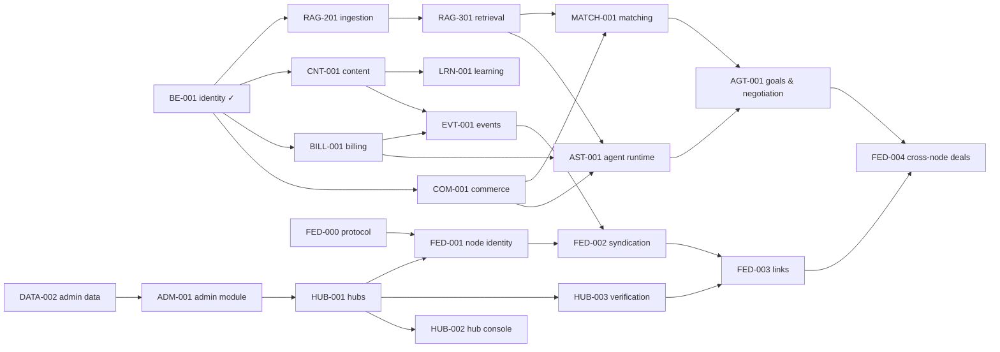

# Roadmap and work packages

Phases sequence the work; they never remove scope from the design. The machine-readable list is [work-packages.json](work-packages.json); `npm run work` shows what can be picked up now, and `node scripts/work-packages.mjs show <ID>` prints one package with its goal, steps, acceptance criteria and owned paths. Statuses below reflect that file on 2026-10-31; the file is the source of truth and is edited in pull requests.

## Phases

| Phase | Outcome | Main packages |
|---|---|---|
| **F0 Foundation** (done) | Specification, ADRs, contracts, coordination | BE-000, DS-000, FND-002, RAG-000, RAG-101, ADM-000 |
| **F1 Identity and shells** (done) | Accounts, sessions, companies, memberships, projects on PostgreSQL; design system; public and workspace shells on demo data | DATA-001, BE-001, DS-001, WEB-001 |
| **F1b International** (done) | Country packs, six languages, any country with any language, sanctions basics | INTL-001, INTL-002, INTL-UZ, INTL-GE, INTL-AM, INTL-AZ, INTL-SAN |
| **F2 Content and commerce core** | Publications and the magazine; paired RFQ, catalogue, quotes and agreements; billing with two budget kinds; identity hardening | CNT-001, COM-001, BILL-001, BE-002 |
| **F3 Agents and knowledge** | Durable mandates and runs with fakes; governed hybrid retrieval; search with cited answers | RAG-201, RAG-301, AST-001, WEB-003, RAG-401 |
| **F4 Execution, trust and administration** | Execution evidence and fair reputation; administration persistence, module and web surface | EXE-001, DATA-002, ADM-001, ADM-002, ADM-003 |
| **F5 Gathering point** | Events, learning, partner matching, agent goals and negotiation | EVT-001, LRN-001, MATCH-001, AGT-001, WEB-002 |
| **F6 Hubs** | Hub model, operator console, counterparty verification, country pack v2 | HUB-001, HUB-002, HUB-003, CTRY-002 |
| **F7 Mesh** | Federation protocol, node identity, syndication, directory links, cross-node deals, federated sign-in | FED-000 … FED-005 |
| **Release** | A standalone release candidate verified end to end | QA-001 |

Phases overlap: packages start as soon as their dependencies are done. FED-000 (the protocol specification) can start today because it only needs the frozen contracts.

## Dependency map

## All work packages

| ID | Title | Status | Depends on |
|---|---|---|---|
| BE-000 | Resolve auth and multi-party access contracts | done | |
| DS-000 | Turn references into screen contracts | done | |
| FND-002 | Freeze v1 domain and API contracts | done | BE-000, DS-000, RAG-101 |
| DATA-001 | Implement initial identity/access persistence | done | FND-002 |
| BE-001 | Implement identity and object policy slice | done | DATA-001 |
| DS-001 | Create independent accessible design system | done | DS-000 |
| WEB-001 | Implement public and workspace shells | done | FND-002, DS-001 |
| RAG-000 | Prepare first-class RAG architecture and deterministic contracts | done | |
| RAG-101 | Resolve corpus, model and retrieval evaluation contract | done | |
| ADM-000 | Platform administration research and screen contracts | done | |
| INTL-001 | Country-pack model, registration identifier and currency abstraction | done | WEB-001, FND-002 |
| INTL-002 | i18n engine and country selector | done | INTL-001, DS-001 |
| INTL-UZ / GE / AM / AZ | Country packs end to end | done | INTL-002 / INTL-UZ |
| INTL-SAN | Sanctions terms template, partner screening hook | done | INTL-001 |
| COM-001 | Paired RFQ, catalogue, quote and agreement slice | open | BE-001, FND-002 |
| BILL-001 | Neutral offers, entitlements and two budget kinds | open | BE-001 |
| CNT-001 | Publications and curated issue proof | open | BE-001, DS-001 |
| BE-002 | Identity hardening follow-ups | open | BE-001 |
| DATA-002 | Administration persistence | open | DATA-001 |
| RAG-201 | Permission-separated ingestion and index lifecycle | open | FND-002, DATA-001, BE-001 |
| RAG-301 | Governed hybrid retrieval and delivery fencing | open | RAG-201, BE-001, FND-002 |
| WEB-003 | Search, cited answers and freshness states | open | WEB-001, DS-001, RAG-301 |
| AST-001 | Durable mandate and action workflow with fakes | open | COM-001, BILL-001, RAG-301 |
| WEB-002 | Commercial and assistant experiences | open | WEB-001, COM-001, AST-001 |
| EXE-001 | Project execution and fair reputation | open | COM-001 |
| ADM-001 | Platform administration backend module | open | DATA-002, BE-001, FND-002 |
| ADM-002 | Administration web surface | open | ADM-001, WEB-001, DS-001, CNT-001, BILL-001 |
| ADM-003 | Deferred administration screens | open | ADM-002, RAG-201, AST-001 |
| RAG-401 | Real RAG quality, security, scale and recovery | open | RAG-301, AST-001, WEB-003 |
| EVT-001 | Events: hosting, registration, tickets, check-in, partner meetings | open | BE-001, CNT-001, BILL-001 |
| LRN-001 | Courses, assessments and verifiable certificates | open | BE-001, CNT-001 |
| MATCH-001 | Capability profiles, needs board, explainable matching, introductions | open | COM-001, RAG-301 |
| AGT-001 | Agent goals, envelopes, negotiation sessions, company mandates, company representative | open | AST-001, MATCH-001 |
| HUB-001 | Hubs, territories, hub-scoped staff, versioned configuration | open | DATA-002, ADM-001 |
| HUB-002 | Hub operator console | open | HUB-001, ADM-002 |
| HUB-003 | Counterparty verification adapters, recipes, sanctions lists | open | HUB-001, INTL-SAN |
| CTRY-002 | Country pack v2 facets for the launch countries | open | INTL-UZ, INTL-GE, INTL-AM, INTL-AZ |
| FED-000 | Mesh protocol and federation contracts | open | FND-002 |
| FED-001 | Node identity, manifest, signatures, peering | open | FED-000, HUB-001 |
| FED-002 | Public syndication, replicas, tombstones | open | FED-001, CNT-001, EVT-001 |
| FED-003 | Directory federation and entity links | open | FED-002, HUB-003 |
| FED-004 | Cross-node deals and agent envelopes | open | FED-003, COM-001, AGT-001 |
| FED-005 | Federated sign-in between peered nodes | open | FED-001, BE-002 |
| QA-001 | Standalone release candidate | open | WEB-002, CNT-001, EXE-001, BILL-001, RAG-401, ADM-002 |

## Open decisions that shape the roadmap

| Decision | Owner | Affects |
|---|---|---|
| Prices, trials, tiers per hub | Owner / hub operators | BILL-001 |
| Reputation weights, windows, minimum samples | Owner | EXE-001 |
| Reference company claim evidence | Decided 2026-10-30 (reference recipes) | HUB-003 |
| Standing company representative agent | Decided 2026-10-30: yes, one per company with an accountable person | AGT-001 |
| Default data licences for federation | Decided 2026-10-30 | FED-002 |
| Electronic agreement validity per country | Local counsel | COM-001, FED-004 |
| Personalized journal policy | Owner | Not scheduled |
