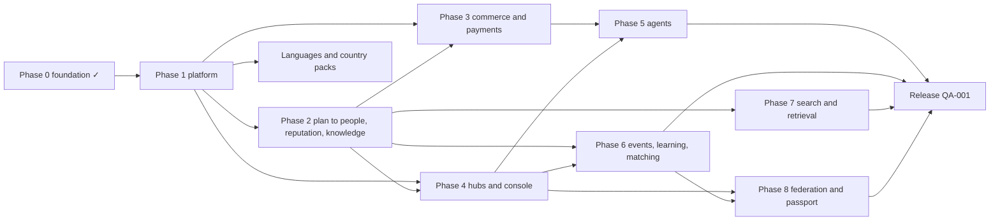

# Roadmap and work packages

Phases order priority; they never remove scope from the design, and dependencies alone decide when a package can be claimed. The machine-readable list is [work-packages.json](work-packages.json): `npm run work` lists what can be picked up now, `npm run work:next` names the available package that unblocks the most other work, `node scripts/work-packages.mjs show <ID>` prints one package and `node scripts/work-packages.mjs issue <ID>` renders its GitHub issue. The file is the source of truth and is edited in pull requests; the tables below were generated from it on 2026-10-31 and may lag behind it.

The plan merges the wave-1 research and design (architecture audit, market scan, agent catalogue, data model, hub console) into one graph; how duplicates were merged and the defaults it needed are recorded in [ADR 012](../adr/012-integrator-decisions-2026-10-31.md). Today the graph has 179 packages: 18 done, 158 open, 2 blocked and 1 rejected (superseded); 29 of them are the languages and country packs of ADR 012 decision 30.

## Rules that keep parallel work safe

- **Paths never collide.** Two packages that own overlapping paths must depend on each other, directly or transitively; `npm run check` fails otherwise. So any set of claimable packages can run at the same time.
- **Migrations live per module** in `packages/data/migrations/<module>/` once DATA-004 is done; a package owns its module directory, its schema mirror file and its repository file. The integrator assigns timestamps at merge.
- **Strings live per feature** in `apps/web/locales/<locale>/<namespace>.json` once INTL-004 is done; a feature adds its namespace in every engine language.
- **Contracts first.** Packages that change shapes start with their contract file and tests; frozen v1 contracts are extended, not edited.
- **Honest status.** `done` only after a maintainer merges accepted work; `blocked` names the owner decision it waits for.

## Phase 0: foundation (done)

Specification, ADRs, contracts, identity and access on PostgreSQL, design system, public and workspace shells on demo data, country packs and six languages, sanctions basics.

| ID | Title | Status | Depends on |
|---|---|---|---|
| BE-000 | Resolve auth and multi-party access contracts | done |  |
| DS-000 | Turn references into screen contracts | done |  |
| FND-002 | Freeze v1 domain and API contracts | done | BE-000, DS-000, RAG-101 |
| DATA-001 | Implement initial identity/access persistence | done | FND-002 |
| BE-001 | Implement identity and object policy slice | done | DATA-001 |
| DS-001 | Create independent accessible design system | done | DS-000 |
| WEB-001 | Implement public and workspace shells | done | FND-002, DS-001 |
| RAG-000 | Prepare first-class RAG architecture and deterministic contracts | done |  |
| RAG-101 | Resolve corpus, model and retrieval evaluation contract | done |  |
| ADM-000 | Platform administration research and screen contracts | done |  |
| INTL-001 | Country-pack model, registration identifier and currency abstraction; remove Russia-only assumptions | done | WEB-001, FND-002 |
| INTL-002 | i18n engine and country selector | done | INTL-001, DS-001 |
| INTL-UZ | Uzbekistan pack end to end | done | INTL-002 |
| INTL-GE | Georgia pack | done | INTL-UZ |
| INTL-AM | Armenia pack | done | INTL-UZ |
| INTL-AZ | Azerbaijan pack | done | INTL-UZ |
| INTL-SAN | Sanctions terms template, partner SDN hook, removal of Russian integrations and plans | done | INTL-001 |

## Phase 1: platform foundation

Make what exists real and deployable before adding domains (ADR 012 decision 9). The web runs on the live API, the worker drains the outbox, mail is delivered, production configuration, logs, readiness and security headers are enforced, images and a full local stack exist, CI fails on the gaps the audit found, locale handling is correct and split per feature, countries, languages, defaults and brand are configuration, Spanish is the seventh language, the US pack and the synthetic US demo hub exist, and staff, audit and moderation basics are in place before user-generated content goes public. **Outcome (QA-002):** on the US demo hub a person signs up, verifies by e-mail, creates a company, invites a colleague, creates and publishes a project and sees it on the public site, on a deployable stack (deployment itself still needs the owner).

| ID | Title | Status | Depends on |
|---|---|---|---|
| DATA-004 | Migration layout for parallel slices: one directory per module, schema mirror per module | open |  |
| CI-001 | Harden the pipeline: required database tests, audits, drift and size checks | open |  |
| OPS-001 | Production runtime baseline: configuration guard, structured logs, readiness, telemetry, security headers | open |  |
| REL-001 | Outbox relay, durable job runner and scheduler in apps/worker | open | DATA-004 |
| BE-002 | Identity hardening follow-ups | open | DATA-004 |
| BE-003 | Account and directory completeness: company creation, handles, lists with pagination | open | DATA-004 |
| MAIL-001 | Transactional mail through the outbox with localized templates and an SMTP adapter | open | REL-001, BE-002 |
| BE-004 | Second factor, recovery codes and elevated sessions | open | MAIL-001 |
| INTL-003 | Locale correctness and weight: request-scoped client locale, one dictionary per page, CLDR plurals, country-aware formats | open |  |
| INTL-004 | Locale files per feature namespace | open | INTL-003 |
| WEB-006 | Asynchronous data boundary in the web app | open | INTL-003 |
| WEB-004 | Run the web app on the live API for accounts, companies and projects | open | WEB-006, BE-003, OPS-001 |
| CTRY-002 | Country pack v2 schema: facets, subdivisions, several time zones and identifiers, unit catalogue | open |  |
| CTRY-003 | Sourced v2 facets for Uzbekistan, Georgia, Armenia and Azerbaijan | open | CTRY-002 |
| CFG-001 | Configuration over code: runtime country packs, languages, defaults and brand | open | CTRY-002, INTL-004, OPS-001, WEB-006 |
| LANG-ES | Spanish (es) as the seventh engine language | open | CFG-001, INTL-004 |
| INTL-US | United States country pack | open | CTRY-002 |
| DEMO-US | United States demo hub: defaults and synthetic demo data | open | INTL-US, CFG-001, LANG-ES, WEB-006 |
| OPS-002 | Container images and a full local stack with same-origin routing | open | OPS-001, REL-001 |
| DATA-003 | Shared kernel persistence: files, units, jurisdictions, taxonomy, exchange rates and the hub anchor | open | DATA-004, CTRY-002 |
| FILE-001 | Object storage port and attachments | open | REL-001, DATA-003 |
| DATA-002 | Administration persistence | open | DATA-003 |
| ADM-001 | Platform administration backend module | open | DATA-002, BE-004 |
| QA-002 | Platform release candidate: the US demo hub on a deployable stack | open | WEB-004, MAIL-001, DEMO-US, OPS-002, ADM-001, CI-001 |

## Phase 2: plan to people, consultations, reputation building and shared knowledge

The flagship journeys of ADR 010 decisions 17 and 18. Profiles with consent, communications, content and the commerce core (RFQs, quotes, agreements) come first because tasks are RFQs and bookings are agreements. **Outcome:** a homeowner's plan becomes consultation and task requests answered by experts and trades; participants build and confirm their reputation from real interactions; completed projects become shared knowledge with consent. Plan-step recommendations from manufacturer and supplier knowledge (decision 19) need the editorial pipeline of phase 4 (MAT-001, REC-001) and the companion module of phase 5 (AGT-021).

| ID | Title | Status | Depends on |
|---|---|---|---|
| PPL-001 | Profiles, consent records, portraits and experience | open | DATA-003, FILE-001, WEB-004 |
| COMMS-001 | Context threads, messages, notifications, channel grants and templates | open | MAIL-001, DATA-003, WEB-004 |
| CNT-001 | Publications, corrections and curated issues: backend | open | DATA-003, PPL-001, FILE-001, ADM-001 |
| CNT-003 | News, articles and the magazine on the API, with the PDF layout | open | CNT-001, WEB-004 |
| PLAN-000 | Open plan-step taxonomy v1 (CC0) with slots for licensed mappings | open |  |
| PLAN-001 | Project plans: versions, items, dependencies, changes, sharing with invited experts, permits and diaries | open | DATA-003, PLAN-000, BE-003 |
| COM-001 | Catalogue, needs, RFQs and invitations (commerce slice 1) | open | DATA-003 |
| COM-002 | Quotes, negotiation, agreements and orders (commerce slice 2) | open | COM-001 |
| CONS-001 | Consultations and mentoring from plan items | open | PLAN-001, COM-002, COMMS-001 |
| TASK-001 | Scoped tasks from plan items for contractors and trades | open | PLAN-001, COM-002 |
| EXE-001 | Project execution and fair reputation | open | COM-002, PLAN-001, FILE-001 |
| REP-001 | Reputation builder: credentials, portfolio, confirmations, contributions and timeliness | open | EXE-001, PPL-001 |
| KNOW-001 | Shared knowledge from completed projects: diaries, lessons, checklists, templates and Q&A | open | CNT-003, PLAN-001, PPL-001 |
| WEB-007 | Plan to people on the web: plan editor, step requests, consultations and tasks | open | PLAN-001, CONS-001, TASK-001, WEB-004 |
| WEB-008 | Reputation builder on the web | open | REP-001, PPL-001 |

## Phase 3: commerce and payments, without ever holding money

Billing with two budget kinds, a provider-neutral payment port that only licensed providers fulfil (ADR 010 decision 20), invoices, tax and payouts through providers, hub commissions as versioned, disclosed settings (decision 21), paid consultations, getting paid on construction terms (pay applications, retainage, lien waivers), commerce screens and field evidence.

| ID | Title | Status | Depends on |
|---|---|---|---|
| BIZ-001 | Hub business-model playbook and the public price-transparency page design | open |  |
| BILL-001 | Neutral offers, entitlements and two budget kinds | open | DATA-004 |
| PAY-001 | Payment provider port: licensed providers only, webhook inbox and reconciliation | open | BILL-001, REL-001 |
| BILL-002 | Invoices, tax determinations, refunds and payouts through licensed providers | open | PAY-001, DATA-003 |
| BILL-003 | Hub commissions and fees as versioned, disclosed settings | open | BILL-001, HUB-001, WEB-004 |
| CONS-002 | Paid consultations and mentoring through the payment provider | open | CONS-001, PAY-001, BILL-003 |
| PAY-002 | Getting paid: pay applications, retainage, lien waivers and payment-timeliness evidence | open | COM-002, PAY-001, EXE-001, INTL-US |
| WEB-002 | Commercial experiences: procurement and sales on the API | open | COM-002, BILL-001, WEB-004 |
| FIELD-001 | Field evidence: RFIs, submittals, change orders, daily logs, punch lists and photos | open | EXE-001 |
| DISP-001 | Dispute evidence packages and mediation referral | open | FIELD-001, PAY-002 |

## Phase 4: hubs and the hub console

Hubs, territories and versioned configuration, jurisdiction settings (decision 22), the setup wizard and one-command install, provider keys and model routes, verification and claims, support without impersonation, privacy operations, the source registry, pipelines, data mining, the autonomous editorial office, manufacturer and supplier knowledge and plan-step recommendations, backups and operations. The console is built fixtures-first in slices (ADM-002, HUBC-002 to HUBC-006), wired to the API (HUBC-007 to HUBC-010) and accepted as a whole by the umbrella HUB-002.

| ID | Title | Status | Depends on |
|---|---|---|---|
| HUBC-000 | Review and freeze the hub console contracts | open |  |
| HUB-001 | Hubs, territories, hub-scoped staff and versioned hub configuration | open | DATA-002, ADM-001, HUBC-000, CFG-001 |
| HUB-005 | Jurisdiction settings: agent disclosure, liability, consent, record-keeping and per-action limits | open | HUB-001, CTRY-002 |
| HUB-004 | Setup wizard backend and first run | open | HUB-001, BE-004 |
| KEYS-001 | Provider connections, secret store, model routes, egress, spending caps and kill switches | open | HUB-001, REL-001 |
| HUB-003 | Counterparty verification adapters, recipes and sanctions list configuration | open | HUB-001, KEYS-001 |
| CLM-001 | Company identifiers, registrations, licences, claims and per-hub verification badges | open | HUB-003, BE-003, REP-001 |
| SUP-001 | Support workspace and account servicing without impersonation | open | ADM-001 |
| PRV-001 | Privacy operations: requests, exports, erasure ledger, legal holds, retention and state privacy rights | open | ADM-001, HUB-001 |
| SRC-001 | Hub source registry with licence flags, legal basis and import review | open | HUB-001, CNT-001 |
| PIPE-001 | Pipeline engine and scheduler | open | SRC-001, KEYS-001 |
| MINE-001 | Local data mining: datasets and entity resolution | open | PIPE-001, HUB-003 |
| PROV-001 | AI provenance and labelling for text, translations and images | open | CNT-001 |
| EDIT-001 | Autonomous editorial office with story clusters | open | PIPE-001, PROV-001 |
| MAT-001 | Manufacturer and supplier knowledge pages: products, guides, training and events | open | PIPE-001, CLM-001, PLAN-000 |
| REC-001 | Plan-step recommendations with explanations, never paid | open | MAT-001, PLAN-001, CONS-001 |
| PLAN-003 | Planner templates and marketplace category rules (hub administration) | open | CONS-001, TASK-001, BILL-003 |
| REG-001 | Public-register and licence-board facts as sourced records | open | HUB-003, PIPE-001 |
| PREQ-001 | Prequalification passport shared by consent | open | REG-001, CLM-001 |
| PRMT-001 | Building permits and inspections as sourced project data | open | REG-001, PLAN-001 |
| INTEG-001 | Integrations: public API, webhooks, CSV import, calendars and accounting adapters | open | KEYS-001, BE-003 |
| OPS-003 | Backup, restore drill and retention automation | open | OPS-002, FILE-001 |
| OPS-004 | Backups, restore drills, updates and health in the console backend | open | OPS-003, HUB-001 |
| INST-001 | One-command installation with Docker Compose and the setup token | open | OPS-002, HUB-004 |
| ADM-002 | Hub console shell, overview, approvals, setup wizard and hub settings on fixtures (console M1) | open | HUBC-000, WEB-004 |
| HUBC-002 | Console M2: keys, models and automation screens on fixtures | open | ADM-002 |
| HUBC-003 | Console M3: editorial office and data screens on fixtures | open | ADM-002 |
| HUBC-004 | Console M4: participants, support and trust screens on fixtures | open | ADM-002 |
| HUBC-005 | Console M5: modules, agents, extensions and billing screens on fixtures | open | ADM-002 |
| HUBC-006 | Console M6: federation, privacy, staff, audit, operations and node console on fixtures | open | ADM-002 |
| HUBC-007 | Console live wiring: shell, setup, hub settings, approvals and staff | open | ADM-002, HUB-004, HUB-005 |
| HUBC-008 | Console live wiring: keys, models, automation, editorial and data | open | HUBC-002, HUBC-003, HUBC-007, PIPE-001, EDIT-001, MINE-001 |
| HUBC-009 | Console live wiring: participants, support, trust, modules, agents and billing | open | HUBC-004, HUBC-005, HUBC-007, SUP-001, CLM-001, PLAN-003, AGT-003, AGT-023 |
| HUBC-010 | Console live wiring: federation, privacy, operations and node console | open | HUBC-006, HUBC-007, PRV-001, OPS-004, FED-001 |
| HUB-002 | Hub operator console (umbrella): end-to-end acceptance of every section | open | HUBC-008, HUBC-009, HUBC-010 |

## Phase 5: agents

The durable agent runtime, goals, envelopes and the company representative, the module registry, metering, detailed participant agent settings with previews (AGT-022), the governed extension registry (AGT-023), the model gateway, the modules of the catalogue, MCP and A2A connections, the single assistant surface and the safety evaluation that must pass before any hub enables a module or extension.

| ID | Title | Status | Depends on |
|---|---|---|---|
| AST-001 | Durable mandate and action workflow with fakes | open | COM-002, BILL-001, REL-001 |
| AGT-002 | Freeze agent catalogue contracts: mandate v2, modules, metering, goals, envelopes, connections | open |  |
| AGT-001 | Agent goals, agent-to-agent envelopes, negotiation sessions, company mandates and the company representative | open | AST-001, AGT-002 |
| AGT-003 | Agent module registry, hub agent policy, job subscriptions and kill switches | open | AGT-001, HUB-001 |
| AGT-004 | Agent metering, quotas, agent plans and usage statistics | open | AGT-003, BILL-001 |
| AGT-022 | Detailed agent settings for every participant, with previews and explanations | open | AGT-003, HUB-005 |
| AGT-023 | Governed extension registry for agent capabilities | open | AGT-003, KEYS-001, EVAL-001 |
| LLM-001 | Model gateway with egress-policy routing and per-mandate cost caps | open | KEYS-001, AST-001, BILL-001 |
| EVAL-001 | Agent safety suite harness mapped to OWASP LLM and Agentic Top 10 | open | AST-001 |
| AGT-005 | Presence agent modules: profile keeper, compliance checker and reputation coach | open | AGT-003, REP-001 |
| AGT-007 | Opportunity agent modules: discovery, opportunity watch, introductions and engagements | open | AGT-003, MATCH-001 |
| AGT-008 | Deal agent modules with consumer mode and the anti-splitting guard | open | AGT-003 |
| AGT-009 | Public tender desk agent module | open | AGT-008, PROC-001 |
| AGT-010 | Project planner agent module: from idea to plan to requests | open | AGT-003, CONS-001, TASK-001, LLM-001 |
| AGT-021 | Plan-step companion agent module | open | AGT-010, REC-001 |
| AGT-013 | Delivery agent modules: project desk and execution clerk | open | AGT-003, EXE-001 |
| AGT-014 | Content and community agent modules | open | AGT-003, EVT-001, LRN-001 |
| AGT-015 | Hub operations assistant and the representative front desk | open | AGT-003 |
| AGT-016 | External agent connections over MCP | open | AGT-003, BE-004 |
| AGT-017 | A2A gateway mapped to agent envelopes | open | AGT-016, FED-001 |
| AGT-018 | The single assistant surface on the live runtime: page, overlay, abilities, settings and connections | open | AGT-022, WEB-004 |
| AGT-019 | Agent safety evaluation across modules, connections and extensions | open | AGT-007, AGT-008, AGT-010, AGT-017, AGT-023 |
| AGT-020 | Validate participant jobs and KPIs with practitioners | blocked |  |
| CHAN-001 | Field-first channels: SMS, WhatsApp, voice notes and offline mobile web | open | AST-001, COMMS-001 |
| DD-001 | Counterparty due-diligence pack as a cited platform deliverable | open | REG-001, AST-001 |

## Phase 6: events, learning and matching

Events with tickets through payment providers, courses and certificates, explainable payment-blind matching with double-opt-in introductions, lead honesty, public procurement opportunities, benchmarking and the homeowner passport.

| ID | Title | Status | Depends on |
|---|---|---|---|
| EVT-001 | Events backend: hosting, registration, tickets, check-in and partner meetings | open | CNT-001, BILL-001, PAY-001 |
| EVT-002 | Events on the web: listings, registration, tickets and organizer screens on the API | open | EVT-001, WEB-004 |
| LRN-001 | Courses, assessments and verifiable certificates | open | CNT-001, WEB-004 |
| MATCH-001 | Capability profiles, needs board, explainable matching and introductions | open | COM-001, CLM-001 |
| MATCH-002 | Lead honesty: consented fan-out for private-client needs and no per-lead charging | open | MATCH-001, BILL-001 |
| WEB-010 | Needs board, partner posts and introductions on the web | open | MATCH-001, WEB-004 |
| PROC-001 | Public opportunities and awards: open needs, bid calendar and sourced track record | open | MATCH-001, REG-001 |
| BENCH-001 | Privacy-safe benchmarking for companies | open | MATCH-001, EXE-001 |
| HOME-001 | Homeowner journey and home passport | open | PAY-002, FIELD-001, MATCH-002 |

## Phase 7: search and retrieval

Governed hybrid retrieval (ADR 007) with permission-separated ingestion, delivery fencing, cited answers and real quality, security, scale and recovery evidence. Earlier phases use structured data and a retrieval port with a fake (ADR 012 decision 20). WEB-005 waits for the owner's URL decision.

| ID | Title | Status | Depends on |
|---|---|---|---|
| RAG-201 | Permission-separated ingestion and index lifecycle | open | CNT-001, REL-001 |
| RAG-301 | Governed hybrid retrieval and delivery fencing | open | RAG-201 |
| WEB-003 | Search, cited answers and freshness states on the web | open | RAG-301, WEB-004 |
| RAG-401 | Verify real RAG quality, security, scale and recovery | open | RAG-301, AST-001, WEB-003 |
| WEB-005 | Cacheable, indexable and lighter public pages | blocked | WEB-004, INTL-004 |

## Phase 8: federation and the portable passport

The mesh of ADR 011: protocol, node identity, syndication, directory links, cross-node deals, federated sign-in, an outbound ActivityPub bridge, and the reputation passport as verifiable credentials signed with node keys.

| ID | Title | Status | Depends on |
|---|---|---|---|
| FED-000 | Specify the mesh protocol and federation contracts | open |  |
| FED-001 | Node identity, manifest, signatures and peering records | open | FED-000, HUB-001 |
| FED-002 | Public syndication, replicas and tombstones | open | FED-001, EVT-001 |
| FED-003 | Directory federation and entity links | open | FED-002, CLM-001 |
| FED-004 | Cross-node deals and agent envelopes | open | FED-003, AGT-001 |
| FED-005 | Federated sign-in between peered nodes | open | FED-001, BE-004 |
| FED-006 | Outbound ActivityPub bridge for publications, issues and public events | open | FED-002 |
| REP-002 | Portable reputation passport: hub-issued verifiable credentials | open | REP-001, FED-001, LRN-001 |

## Languages and country packs

International by default ([ADR 012 decision 30](../adr/012-integrator-decisions-2026-10-31.md#owner-decision-of-2026-10-31-international-by-default)). A parallel track: the order of the tables is the priority, and each package becomes claimable as soon as its dependencies are done. LANG-ES, INTL-US and CTRY-003 belong to phase 1 and are repeated here for completeness. The live and planned state per language and country is in [Languages and countries](localization.md#languages-and-countries).

**Languages.** New languages wait for the US demo content (DEMO-US) so translators work on the content that ships, and for review-status metadata (INTL-007). Arabic needs right-to-left support (INTL-005, after WEB-005 splits the public stylesheets); Chinese, Hindi and Japanese need CJK and Devanagari typography (INTL-006).

| ID | Title | Status | Depends on |
|---|---|---|---|
| LANG-ES | Spanish (es) as the seventh engine language | open | CFG-001, INTL-004 |
| INTL-007 | Locale review status: per-locale metadata shown in the language picker and the docs | open | CFG-001, INTL-004 |
| LANG-PT | Portuguese (pt) with formats per country (pt-BR, pt-PT) | open | CFG-001, INTL-004, INTL-007, DEMO-US |
| LANG-FR | French (fr) with formats per country (fr-FR, fr-CA and others) | open | CFG-001, INTL-004, INTL-007, DEMO-US |
| LANG-DE | German (de) with formats per country (de-DE, de-AT, de-CH) | open | CFG-001, INTL-004, INTL-007, DEMO-US |
| LANG-IT | Italian (it) with formats per country | open | CFG-001, INTL-004, INTL-007, DEMO-US |
| LANG-PL | Polish (pl) | open | CFG-001, INTL-004, INTL-007, DEMO-US |
| LANG-UK | Ukrainian (uk) | open | CFG-001, INTL-004, INTL-007, DEMO-US |
| LANG-TR | Turkish (tr) | open | CFG-001, INTL-004, INTL-007, DEMO-US |
| INTL-005 | Right-to-left support: direction per locale, logical CSS, mirrored icons and bidi isolation | open | INTL-004, WEB-005 |
| LANG-AR | Arabic (ar), right to left | open | CFG-001, INTL-004, INTL-007, DEMO-US, INTL-005 |
| INTL-006 | CJK and Devanagari typography: font fallbacks, line breaking, no forced uppercase | open | INTL-004, INTL-005 |
| LANG-ZH | Chinese, Simplified script (zh-Hans) | open | CFG-001, INTL-004, INTL-007, DEMO-US, INTL-006 |
| LANG-HI | Hindi (hi), Devanagari script | open | CFG-001, INTL-004, INTL-007, DEMO-US, INTL-006 |
| LANG-JA | Japanese (ja) | open | CFG-001, INTL-004, INTL-007, DEMO-US, INTL-006 |

**Country packs.** The United States pack comes first and is the model. EU members inherit a shared EU layer (CTRY-EU). Ukraine covers government-controlled territory only. Every fact cites an official source or is labelled with its lower verification level.

| ID | Title | Status | Depends on |
|---|---|---|---|
| INTL-US | United States country pack | open | CTRY-002 |
| CTRY-003 | Sourced v2 facets for Uzbekistan, Georgia, Armenia and Azerbaijan | open | CTRY-002 |
| CTRY-CA | Canada country pack | open | CTRY-002 |
| CTRY-MX | Mexico country pack | open | CTRY-002 |
| CTRY-BR | Brazil country pack | open | CTRY-002 |
| CTRY-GB | United Kingdom country pack | open | CTRY-002 |
| CTRY-EU | European Union layer shared by member-state packs | open | CTRY-002 |
| CTRY-DE | Germany country pack | open | CTRY-002, CTRY-EU |
| CTRY-FR | France country pack | open | CTRY-002, CTRY-EU |
| CTRY-ES | Spain country pack | open | CTRY-002, CTRY-EU |
| CTRY-IT | Italy country pack | open | CTRY-002, CTRY-EU |
| CTRY-PL | Poland country pack | open | CTRY-002, CTRY-EU |
| CTRY-UA | Ukraine country pack | open | CTRY-002 |
| CTRY-TR | Türkiye country pack | open | CTRY-002 |
| CTRY-AE | United Arab Emirates country pack | open | CTRY-002 |
| CTRY-IN | India country pack | open | CTRY-002 |
| CTRY-AU | Australia country pack | open | CTRY-002 |

## Release

A standalone release candidate verified end to end before any public deployment proposal.

| ID | Title | Status | Depends on |
|---|---|---|---|
| QA-001 | Verify the standalone release candidate | open | QA-002, WEB-002, WEB-007, WEB-008, KNOW-001, RAG-401, HUB-002, OPS-003, AGT-018, AGT-019, EVT-002, WEB-010 |

## Superseded

| ID | Title | Status | Depends on |
|---|---|---|---|
| ADM-003 | Deferred administration screens (superseded) | rejected | ADM-002 |

## Dependency map (phase level)

The critical path of phase 1 runs INTL-003 → WEB-006 → WEB-004 for the web and DATA-004 → REL-001 → MAIL-001 → BE-004 → ADM-001 for the platform; CTRY-002 → INTL-US and CFG-001 → LANG-ES → DEMO-US carry the US demo hub. Contracts (HUBC-000, AGT-002, FED-000), the open plan-step taxonomy (PLAN-000) and the business-model playbook (BIZ-001) can start at once.

## Decisions that shape the roadmap

| Decision | Owner | Affects |
|---|---|---|
| Phase order, defaults and merged packages | Decided 2026-10-31 by the integrator ([ADR 012](../adr/012-integrator-decisions-2026-10-31.md)) | Whole graph |
| No held funds; commissions as hub settings; detailed configuration and extensions | Decided 2026-10-31 by the owner ([ADR 010](../adr/010-gathering-point-hubs-agents-and-mesh.md) decisions 20–22) | PAY-001, BILL-002, BILL-003, HUB-005, AGT-022, AGT-023 |
| Hosting and operator entity of the US demo hub; real sign-ups or demo only | Owner (ADR 012 questions 1–2) | QA-002 follow-up, any deployment |
| Language and country in public URLs | Owner (ADR 012 question 3) | WEB-005 (blocked) |
| Prices, trials, tiers and commission levels | Owner / hub operators | BILL-001, BILL-003 activation |
| Reputation weights, windows, minimum samples | Owner | EXE-001, REP-001 public scores |
| Agent liability and disclosure wording per jurisdiction; electronic agreement validity | Counsel per hub | HUB-005 defaults, COM-002 and AGT-008 live use |
| Practitioner interview programme | Owner | AGT-020 (blocked) |
| Personalized journal policy | Owner | Not scheduled |
| International by default: language and country-pack roadmap, honest review status | Decided 2026-10-31 by the owner ([ADR 012](../adr/012-integrator-decisions-2026-10-31.md) decision 30) | LANG-PT … LANG-JA, INTL-005 … INTL-007, CTRY-EU, CTRY-CA … CTRY-AU |
